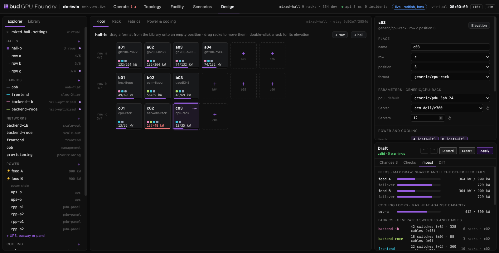
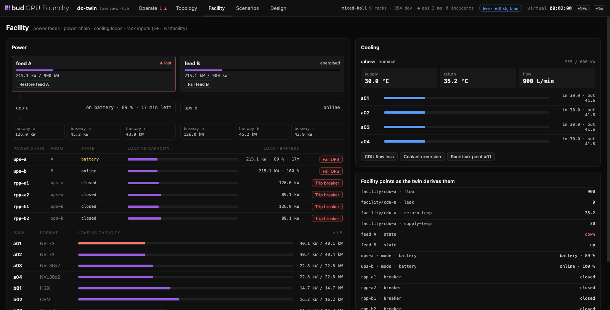

# dc-twin

**A standalone emulated datacenter for testing the software that runs real datacenters.**

dc-twin builds a datacenter out of emulated devices: BMCs, servers, accelerators, DPUs, switches,
fabric managers, power shelves, PDUs, CDUs and leak sensors. Every device speaks the protocol its
real counterpart speaks, so software installed on top can be tested **unmodified**. That software
includes bare-metal lifecycle managers, fabric managers, fleet-health agents, Kubernetes operators
and facility integrations.

The first stack it targets is **NVIDIA DSX OS**: Infra Controller (NICo), DOCA Platform Framework,
NVSentinel, Fleet Intelligence, DSX Exchange, AI Cluster Runtime and KAI Scheduler. The core is
vendor-neutral. AMD Instinct, Intel Gaudi, other OEMs and other rack formats are added as **packs**
of device profiles and stack definitions, without changing the engine.

> **Status: early, and it runs.** The engine, the compiler, ten packs and twelve protocol adapters
> work, and real stacks run against the twin unmodified, among them NVIDIA Infra Controller (NICo),
> OpenStack Ironic, Tinkerbell, KAI Scheduler and Prometheus. The estate schema is `v1alpha1` and
> may still change. What runs, what is not built yet, and every result with its limits are in the
> **[implementation status](docs/implementation.md)**.

## Quick start

```bash
make build                                   # bin/dctwin, bin/refstack
bin/dctwin assets fetch                      # the captured BMC trees vendor dialects bind (MIT)
bin/dctwin up examples/estates/lab-model.yaml --adapters redfish,dhcp,bms,snmp,ipmi,ufm,nvue
bin/dctwin status
bin/dctwin fault inject 'a01/compute-tray-07/gpu-2' nvidia/xid/xid-79
bin/dctwin scenario run examples/scenarios/twin/xid-and-switch-tray.yaml
bin/dctwin down
make test                                    # unit, adapter and end-to-end suites
make compat-libredfish                       # NICo's libredfish integration suite against the twin
```

## The console

The console watches, breaks and designs a running twin from the browser. Start a twin with it and
open the address `dctwin ui` prints (it carries the estate's token):

```bash
bin/dctwin up examples/estates/mixed-hall.yaml --adapters redfish,bms --console console
bin/dctwin ui
```


**Operate** draws the hall from the twin's layout: racks with their health, and on the floor the
power chain from switchgear and UPS through each row's panels, a lane per network fabric, and each
cooling loop. Click a rack for its elevation, a device for its components, interfaces and fidelity,
and **Break it** to inject a catalogue fault or a technician act; the event stream follows every
consequence and every request the software under test makes. Above, Xid 79 on a GPU has taken
its tray Critical and the NVL72 domain to degraded.

 

**Design** (left) edits the estate file as a draft: halls, rows and racks dragged from the packs'
formats, parameters and slots, fabrics and networks, feeds, the UPS and panel chain, cooling
loops, fidelity, cabling and stacks. The twin checks every change by compiling it, and shows the
impact (power and cooling against capacity, switches and cables per fabric, VM cost on this host),
the diff in the file's own layout, and suggested fixes; **Apply** restarts the estate on it and
**Export** downloads it. **Facility** (right) shows feeds, the power chain and the cooling loops
live: here feed A is lost and UPS-A carries its side on battery. More in the
[console's README](console/README.md).

## What it is for

- **Testing a datacenter stack before the hardware arrives.** Rack ingestion, firmware baselines,
  tenant hand-over and sanitisation, fault remediation, leak response, power capping.
- **Running the failures you can't safely stage on real machines.** A leak in rack A07, a switch
  tray dying mid-allocation, a BMC that stops answering, a GPU that falls off the bus. Each one is
  injected into the model and shows up consistently on every interface that would reveal it.
- **Scale.** Thousands of emulated BMCs and Kubernetes nodes on one machine, at reduced fidelity.
- **Comparing stacks.** The same estate and the same scenarios, run against different vendors'
  software.
- **Seeing and steering it.** A web console shows the estate from hall floor to rack elevation to
  a single GPU. It adds racks and machines, injects faults and technician acts, and follows every
  request the software under test makes in response ([UI](docs/spec/12-ui.md)).

## What it is not

- **Not a performance simulator.** No CUDA or ROCm kernels run, no NCCL bandwidth exists, and no
  packet in the twin says anything about what real silicon would do.
- **Not a security proof.** Hardware-rooted guarantees, such as DPU-enforced isolation,
  confidential-computing attestation and real firmware signing, cannot be proven in emulation. The
  twin says so wherever a result depends on them ([fidelity](docs/spec/07-fidelity.md)).
- **Not a replacement for hardware.** Whatever the twin cannot model is listed, and its
  hardware-in-the-loop mode exists to keep the emulators honest.

## Repository layout

| Path | What is there |
|---|---|
| [`cmd/dctwin`](cmd/dctwin) | The CLI: `validate`, `up`, `fault`, `scenario run`, `ui` and the rest |
| [`internal/compile`](internal/compile) | The compiler: an estate file and the packs become the model, with every validation rule |
| [`internal/engine`](internal/engine) | The single-writer engine: power, sensors, faults, the event log, the clocks |
| [`internal/adapter`](internal/adapter) | One package per protocol: Redfish, DHCP, BMS, SNMP, IPMI, UFM, NVUE, NMX-C, RMS, VMs, … |
| [`internal/control`](internal/control) | The control API the CLI and the console use, and the estate drafts |
| [`packs`](packs) | Device profiles, rack formats, fabric templates and fault catalogues, per vendor |
| [`stacks`](stacks) | Stack definitions (NVIDIA DSX OS, a reference stack) |
| [`console`](console) | The web console ([README](console/README.md)); no build step. [`prototype`](prototype/README.md) is the first one |
| [`examples`](examples) | Estates and scenarios to start from |
| [`compat`](compat) | Harnesses that drive the twin with real, unmodified clients ([README](compat/README.md)) |
| [`test`](test) | End-to-end suites |
| [`docs/spec`](docs/spec/README.md) | The specification, with its decisions in [11-decisions](docs/spec/11-decisions.md) |
| [`docs/implementation.md`](docs/implementation.md) | What is built, what is not, and every result |

## Contributing

Contributions are welcome: new hardware, protocols, stacks, scenarios, console work and fixes.
Open an [issue](https://github.com/BudEcosystem/dc-twin/issues) to discuss a larger change before
you start, or send a [pull request](https://github.com/BudEcosystem/dc-twin/pulls).

```bash
make build        # bin/dctwin
make test-short   # unit and adapter tests, quick
make test         # everything, with the end-to-end suites (about four minutes)
make help         # every target, the compat harnesses among them
```

Where to start:

- **New hardware** is a pack, not engine code: device profiles, rack formats, fabric templates
  and fault catalogues under [`packs/`](packs) ([packs and stacks](docs/spec/06-packs-and-stacks.md)).
- **A new protocol** is an adapter under [`internal/adapter`](internal/adapter), checked against a
  real client of that protocol ([testing](docs/spec/16-testing.md)).
- **A new stack** is a definition under [`stacks/`](stacks) and a harness under [`compat/`](compat).
- **The console** is plain JavaScript under [`console/`](console): edit and reload.

The design lives in [docs/spec](docs/spec/README.md). A change that alters behaviour, a schema or
an interface updates the spec with it, and a result goes into
[docs/implementation.md](docs/implementation.md) with the client it was checked against.

## Prior art

- [RafaySystems/brave](https://github.com/RafaySystems/brave) — virtual bare metal for EKS
  Anywhere on one cloud instance. It inspired the "one big box" deployment model here.
- The mocks NVIDIA ships inside its own components. dc-twin reuses them where they fit
  ([NVIDIA DSX OS stack](docs/stacks/nvidia-dsx-os.md)).
- DMTF's Redfish mockups.
- [containerlab](https://containerlab.dev).

## License

Apache-2.0. dc-twin never redistributes vendor binaries or images that their licences don't allow
to be redistributed. A stack pack says how to obtain them ([D13](docs/spec/11-decisions.md)).
