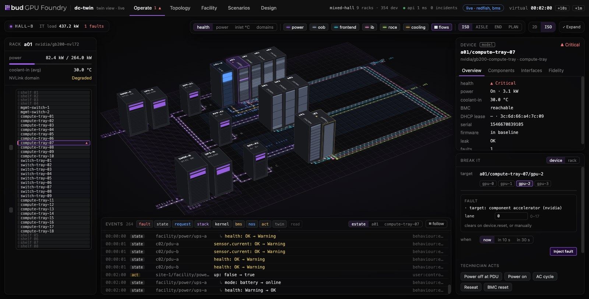

# Console (twin view v2)

The dc-twin console from the *Twin Console v2* design: one page with five screens.



| Screen | What it shows and does |
|---|---|
| **Operate** | The hall in ISO (CSS 3D: drag to orbit, eased, with a short coast after a flick; shift-, alt-, right- or two-finger drag to pan; scroll or pinch to zoom, about the point under the cursor; double-click a point to orbit around it; a camera preset resets) or 2D (drag to pan), with health / power / inlet / domain overlays and the hall's services on the floor, each a layer you can switch: power along the back of each row (two feeds from the row's panel, a tap into every rack), the networks along the front (a lane per cabled fabric, such as OOB, frontend, backend InfiniBand and RoCE, each in its own colour, with a tap from every rack that has a port on it and a trunk to the rack where the fabric is switched), and cooling further out in front of each loop's racks (a CDU per loop; a loop with no racks after the last row, marked). Every feed is drawn, and every node of the power chain: a panel that serves no rack sits under its feed, marked. A tap turns red and dashed when its feed is down or its cable pulled. Floating panels: the selected rack's elevation, the device (overview, components, interfaces, fidelity), **Break it** (catalogue faults for the device or rack, technician acts, active faults, chaos) and the event stream with cause chains |
| **Topology** | A fabric's spines, leaves and racks; click a link to pull or replace its cable. The NVLink matrix of a rack-scale rack |
| **Facility** | Feeds with their load, the power chain (each UPS, busway and panel with its state, load and battery, and an act to fail a UPS or trip a breaker), every rack's load against capacity and per feed, the cooling loop and its CDU, and the facility points |
| **Scenarios** | Run a scenario and read its steps, assertions and fidelity report |
| **Design** | On a live twin, a designer for the whole estate file (below). In the demo: draft racks into empty positions, or click a rack to remove it, and apply |

No build step and no external request: `index.html`, `console.css`, the scripts in `js/` and the
Bud GPU Foundry logo and mark in `img/`.

## Two modes

**Live.** Served by a twin, with the estate token:

```bash
make build
bin/dctwin up examples/estates/mixed-hall.yaml --adapters redfish,bms --console console
bin/dctwin ui            # prints http://127.0.0.1:<port>/?token=<token>
```

Live mode is chosen when the page carries `?token=` and `GET /v1/status` answers on the same
origin. Everything comes from the control API: `/v1/layout`, `/devices`, `/facility`, `/links`,
`/domains`, `/faults`, `/catalogue`, `/report` and `/events/stream`, and every act is a call
(`/faults`, `/faults/clear`, `/power`, `/reseat`, `/bmc/reset`, `/feeds`, `/cable`, `/chaos`,
`/clock/advance`, `/scenarios/run`, `/estate/plan`, `/estate/apply`). On a virtual clock the top bar offers **+10s / +1m**.

When feeds A and B each reach the racks through a UPS (`facility.power.topology`), the floor draws
the switchgear, the UPS and a panel per row and feed from the twin's power chain, and their acts
are a feed loss (`POST /v1/feeds`), `generic/power/ups-failure` and `generic/power/breaker-trip`.
An estate with no chain, or another shape of one, draws a box per feed, and its chain is on the
Facility screen.

What live mode leaves out, because the twin does not model or serve it:

- **Hot apply.** Apply is a *restart* apply (`POST /v1/estate/apply`), not the spec's hot change
  (03 — Changing a running estate): the twin writes the changed estate to
  `<state>/<estate>.applied.yaml` (your estate file is not touched), brings the estate down and up
  again on it on the same address and token, and keeps the old event log beside the new one. Device
  identities survive (they derive from the seed and the path), but active faults, power changes and
  the event log start fresh, and a stack sees every BMC drop and come back. The console asks for a
  confirmation, follows the restart and reconnects. If the changed estate does not come up, the
  previous one is brought back.
- **Scheduled faults** ("in 10 s") are timers in this browser, not in the twin.
- **Chaos state** has no read; the toggle shows what this page last set.
- The catalogue's per-profile allow-list is not served, so an inject the profile refuses comes
  back with the twin's reason.

## The designer

Design on a live twin started from an estate file edits that file as a **draft**: a list of
changes, each an operation on the file (`set`, `add`, `remove`, `move` at a path such as
`spec.fabrics[name=backend-ib].select`, or an intent such as `rack.add`, `rack.move`,
`rack.rename`, `row.add`, `hall.remove` that also fixes every reference to what it changes). After
every change the twin plans the draft (`POST /v1/estate/plan {etag, ops}`): it edits the file in
its author's layout (only the lines a change reaches are rewritten; comments, blank lines and
spacing stay as written), compiles it and returns the problems, warnings, a unified diff, the edited
file, the compiled layout and the impact. There is no compiler in the browser.

- **Explorer and Library** (left): the estate's halls, rows and racks, fabrics, networks, feeds and
  power chain, cooling loops, facility devices, BMS, fidelity overrides, cabling and stacks; the
  Library has every rack format, device profile and fabric template of the packs
  (`GET /v1/catalogue?detail=full`), to drag onto the floor or arm and click.
- **Views** (middle): **Floor** (drag a format onto an empty position, drag a rack to move it,
  double-click for its elevation; new, moved and removed racks are marked, each with its max draw
  against capacity), **Rack** (the elevation from the compiled draft, so a parameter that adds
  servers shows them; fill a slot with a profile its `accepts` lets in, empty it or reset it),
  **Fabrics** (each fabric from its hub to the racks it reaches, with **suggested fixes** for what
  the compiler warns about, such as racks whose InfiniBand ports are on no fabric) and **Power &
  cooling** (feeds, the chain of UPS, busway and panels, and loops, each against capacity at max
  draw, shared and if the other feed is lost, with suggested fixes for what carries nothing: a
  panel that serves no rack, racks it serves that draw from another feed, a feed no rack draws
  from, a loop with no racks).
- **Inspector and Draft** (right): a form for the selected object, built from the pack's
  parameter declarations; selectors are picked on the floor. The draft lists the changes (undo,
  redo, drop one), the twin's checks, the impact (feeds, chain nodes, loops, fabric switches and
  cables, VM cost against this host from `GET /v1/host`, stack capabilities, racks) and the diff,
  each change labelled hot or cold.
- **Export** downloads the edited file. **Apply** restarts the estate on it (below). A draft is
  kept in this browser per estate and file version; if the file changes under it, the twin refuses
  the draft (`409`) and it is made again.

**Demo.** Opened any other way (a plain file server, or without a token), the page runs an
illustrative hall in memory, `hall-a-demo`: a fault engine, a simulated stack labelled `(sim)`,
UPS and switchgear, scenarios and design apply. Durations are shortened and every number is
illustrative. `?speed=2|4` speeds it up and `?stack=off` turns the simulated stack's responses off;
`?view=2d` starts on the 2D floor in either mode.

## Structure

```
index.html            shell
console.css           base, hover states, the Bud design-system buttons, animations, the top bar's narrow-screen rules
img/                  the Bud GPU Foundry logo (white, for the dark top bar) and the Bud mark (the tab icon)
js/h.js               a small virtual DOM (the page re-renders each second without restarting animations)
js/data.js            severities, formats, event kinds, the demo catalogue, helpers
js/demo.js            the in-memory demo
js/live.js            the control API client: cache, event stream, acts
js/views-cockpit.js   top bar and Operate (ISO scene, 2D floor, panels)
js/views-screens.js   Topology, Facility, Scenarios, Design (the demo's)
js/designer/          the designer: draft.js (the draft, paths and selectors), forms.js (fields),
                      shell.js (layout, Explorer, Library, the draft panel), floor.js, rack.js,
                      fabrics.js, facility.js, advanced.js (fidelity, cabling, stacks, settings)
js/app.js             state, source selection, render loop, and the camera. It orbits, pans and
                      zooms about the orbit centre: the floor point at the middle of the view
                      (marked while the camera moves), the middle of the hall until you pan or
                      double-click elsewhere. Pan and zoom go through the perspective projection
                      CSS applies, so a grabbed point stays under the cursor
```

Both sources expose the same shape (racks, devices, events, active faults, acts), so every screen
is drawn by the same code in either mode.
