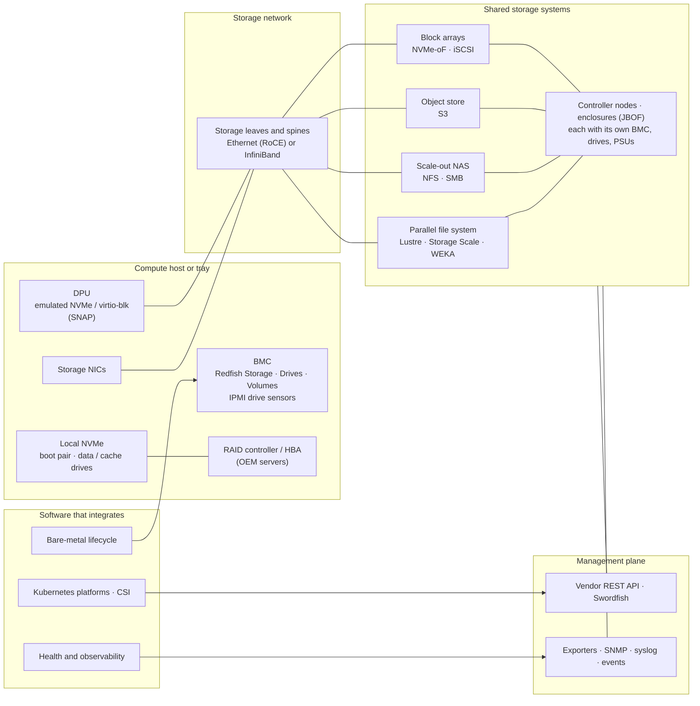

# Storage deep dive — 2026-11-08

What storage the twin has; what a datacenter's storage is made of; which software integrates with
it and what that software expects; and what the twin would need to emulate it, both for its own
fidelity and for teams that want to test their software's integration with a datacenter's storage
before the hardware exists. **Nothing here is decided.** Section 8 lists the decisions to take,
section 9 proposes a phased path, and section 10 registers each finding (`S-nn`) so that later
changes can cite the one they close, as the [spec review](2026-10-18-spec-review.md) does.

Read on 2026-11-08 from this repository at `24f3187`, the harnesses' recorded results, a local
QEMU 11.1.2, and the public documentation in [Sources](#sources).

## 1. Where the twin stands

| | What | Where |
|---|---|---|
| **Built** | Drives as components of a host: `kind: drive`, a count and a model string the capacity is parsed from | every pack's server profiles; [`model.DriveBytes`](../../internal/model/sizes.go) |
| | The generated DMTF tree's `Systems/1/Storage` → `Storage/1` → `Drives/{id}`: `CapacityBytes`, `Protocol`, `MediaType: SSD`, status from the component's health | [generated.go](../../internal/adapter/redfish/generated.go) |
| | IPMI chassis status's drive-fault bit | [commands.go](../../internal/adapter/ipmi/commands.go) |
| | KWOK nodes' `ephemeral-storage`: one drive, as the kubelet's root file system | [project.go](../../internal/adapter/kwok/project.go) |
| | The BlueField Arm's 40 GiB sparse NVMe disk, which NVIDIA's installer partitions and the twin boots from | [arm.go](../../internal/adapter/bluefield/arm.go), [armdisk.go](../../internal/adapter/bluefield/armdisk.go) |
| | The network role `storage`: accepted by the compiler, cabled by the Clos templates, offered by the console | [compile.go](../../internal/compile/compile.go), [fabrics.go](../../internal/compile/fabrics.go) |
| | The canonical request `erase.start` (SecureErase, Drive.SecureErase): classified, with no behaviour behind it | [14](../spec/14-expressions.md), [handler.go](../../internal/adapter/redfish/handler.go) |
| **Specified, not built** | `generic/storage-rack` and the `storage` rack archetype | [04](../spec/04-devices-and-racks.md#the-formats), [06](../spec/06-packs-and-stacks.md), [13](../spec/13-schemas.md) |
| | The `generic/storage` fault catalogue: drive failure, SMART warnings | [08](../spec/08-scenarios-and-faults.md) |
| | "Real disk" at `vm` fidelity. A `vm` host has no block device; only the BlueField Arm does | [07](../spec/07-fidelity.md#levels), [vm.go](../../internal/adapter/vm/vm.go) |
| | `redfish/secure-erase`, secure erase in NICo's Redfish call list, and the M1 conformance scenario `tenant-release-sanitise` ("NVMe secure erase … observed from the hardware side") | [06](../spec/06-packs-and-stacks.md#the-capability-contract), [05](../spec/05-interfaces.md#management), [stack doc](../stacks/nvidia-dsx-os.md#conformance-scenarios) |
| **Absent from the spec** | Storage controllers and RAID volumes; the contents of a disk (empty, installed, erased); DPU-provided storage; any shared storage system (parallel file system, NAS, object store, block array) and its management API; storage metrics; a storage row in the vendor slots table ([06](../spec/06-packs-and-stacks.md#the-same-slots-every-vendor)); storage in the Kubernetes view beyond `ephemeral-storage` | — |

Two smaller facts belong here. A `model` host that is not network-booted "boots from disk" whatever
its disks hold ([bmcstate.go](../../internal/engine/bmcstate.go), `boot`): the model has no notion of
what is on a drive, so an erased host still reaches `os`. And no device profile in any pack has a
port with `role: storage`, so a `storage` network has nothing of its own to cable. `lab-model.yaml`
declares one (`backend-roce`), but its fabric is a `rail-optimised` template, which cables
`scale-out`-role ports ([fabrics.go](../../internal/compile/fabrics.go), `genRail`): the storage
network is the GPUs' RoCE rails under another name. The DGX H100 profile has no storage ports,
although the real system's two dual-port ConnectX-7 adapters carry storage and in-band traffic.

## 2. What storage is in an AI datacenter



| Layer | Hardware | Who talks to it | Through |
|---|---|---|---|
| **Drives in hosts** | NVMe (U.2, E1.S, M.2), SATA or SAS drives; a boot pair and data or cache drives | bare-metal managers (inventory, root device, RAID, sanitisation, image to disk), fleet health (SMART, endurance), Kubernetes (ephemeral storage, local volumes) | BMC: Redfish `Storage`, `Drive`, `Volume`, `StorageController`, `Drive.SecureErase`, log entries; IPMI drive-slot sensors and SEL. Host: the NVMe controller (identify, SMART log, format, sanitize, firmware), `/dev/disk/by-id`, the kernel log |
| **Storage controllers** | RAID controllers and HBAs in OEM servers (Dell PERC and BOSS, HPE Smart Array, Broadcom MegaRAID) | Ironic and Metal3 RAID, OEM tooling | Redfish `StorageController` (supported RAID types), `Volumes` create and delete with an apply time, OEM job queues |
| **DPU-provided storage** | A BlueField presenting NVMe or virtio-blk functions to its host, backed by remote storage over NVMe-oF | DPF and NICo (provisioning the service), the host OS (it sees a drive) | DPF's DPU services; the host's PCIe inventory; NVMe-oF to the storage system |
| **Storage network** | Storage NICs on hosts, storage leaves and spines, Ethernet with RoCE or InfiniBand | fabric managers, switch automation, NICo/DPF tenant isolation | the fabric's own interfaces (already in the twin), port roles |
| **Shared storage systems** | Controller nodes, enclosures and their drives, each with a BMC and PSUs; a cluster that serves file, object or block | CSI drivers, AI platforms (data sources, model caches), operators, monitoring, capacity planning | the vendor's management REST API (or SNIA Swordfish), Prometheus exporters, SNMP, syslog; the data path (NFS, S3, NVMe-oF, a parallel file system client) |
| **Kubernetes consumption** | — | schedulers, AI platforms, operators | `StorageClass`, `PersistentVolumeClaim`, CSI objects (`CSIDriver`, `CSINode`, `CSIStorageCapacity`, `VolumeAttachment`), `ephemeral-storage` |
| **Facility** | Storage racks: power, air cooling, space | DCIM, the console's Design | power and cooling like any rack |

### What NVIDIA's reference architectures put there

| | Storage network | Local drives | Tiers |
|---|---|---|---|
| **DGX SuperPOD, GB200** [1–3] | Ethernet with RoCE on the BlueField-3's ports (two of each DPU's four 200 GbE ports are for storage; 2 × 200 Gb/s per tray), through Spectrum-4 SN5600 switches it shares with in-band management, as **a storage VXLAN of its own** terminated on the leaves; 16 × 800 G per scalable unit to the appliances. "RoCE is a basic requirement for the storage appliances" | 4 × 3.84 TB E1.S NVMe in RAID 0 as a local cache, and a 1.92 TB M.2 OS drive, per tray | a high-performance parallel file system from a certified partner over RoCEv2; user storage over NFS on the in-band network (home directories, logs); the local cache |
| **DGX SuperPOD, H100** [4, 5] | an InfiniBand storage fabric (Quantum-2 QM9700), about 4:3 oversubscribed; on each DGX H100, the ConnectX-7 adapters in slots 1 and 2 carry storage, bonded with in-band on Ethernet or on their first port on InfiniBand [9] | — | over 40 GB/s per node for GPUDirect Storage reads |
| **DGX SuperPOD, B300** [6] | InfiniBand NDR storage, or Spectrum-4 Ethernet with RoCE | — | — |
| **NVL72 Enterprise RA, GB300** [7] | one dual-port BlueField-3 B3240 per tray for north-south and storage; the four ConnectX-8 carry east-west and support GPUDirect Storage | 4 × E1.S per tray, "fast, local cache" | — |
| **HGX Enterprise RA** [8] | a BlueField-3 B3220 (2 × 200 G) for "in-band management and storage" | — | — |

Checkpoints are what drive the sizing: synchronous, terabytes at a time, stalling training while
they write [3]. NVIDIA's certified storage list (2026-10-27) names, at the SuperPOD tier, Dell
PowerScale, DDN AI400X3, Pure FlashBlade//S, IBM Storage Scale System, NetApp AFF A90 and AFX,
VAST and WEKA; lower tiers add Cisco, HPE, Hitachi and Nutanix [10]. GPUDirect Storage moves data
between storage and GPU memory without a CPU bounce buffer, through cuFile and the `nvidia-fs`
module [14]; it is silicon, and the twin cannot show it.

Two consequences for the twin. The GB trays' storage is **a second network on the BlueField's
frontend ports**, which the model's one role per port cannot say (S-07). And the tray profiles'
drives disagree with these pages: `nvidia/gb300-compute-tray` has four 3.84 TB drives and no OS
drive; `nvidia/gb200-compute-tray` has eight (S-14).

## 3. Who integrates with storage, and what they need the twin to answer

| Integration | Examples | What it tests | What the twin must answer |
|---|---|---|---|
| **Bare-metal lifecycle** | NICo, Ironic, Metal3, MAAS, Tinkerbell | inventory against the expected machine; root-device choice; hardware or software RAID; installing an image to disk and booting from it; sanitising drives between tenants; drive firmware | Redfish storage with stable serials, sizes and identifiers; RAID volumes; secure erase that really erases; at `vm`, NVMe drives the installer and the cleaning ramdisk can see, write and erase |
| **Fleet health and remediation** | NVSentinel, Fleet Intelligence, node-problem-detector, medik8s | detecting a failing drive, a full file system, I/O errors, and acting (cordon, drain, ticket, replace) | drive faults projected consistently to Redfish, IPMI, the guest's NVMe SMART log, the kernel log and metrics |
| **Kubernetes platforms and schedulers** | Run:ai, KAI, Kueue, AI platforms that onboard clusters | storage classes present and defaulted; claims bound; data sources mounted; model caches on node-local NVMe; capacity-aware placement | `StorageClass`es and CSI objects in the cluster; claims that bind; for anything that mounts, a real data path |
| **DPU host isolation** | DPF, NICo | provisioning a storage service on the DPU and handing the host a tenant's volume | the DPU service's objects, a device that appears on the host, and its backing target |
| **Storage control-plane integrations** | CSI drivers, operators, exporters, ticketing and capacity tools written against a storage vendor's API | create and delete volumes, shares, quotas, snapshots, tenants; read capacity, health and alerts | the vendor's management API at the calls those clients make, bound to model state; faults that change what it answers |
| **Observability and inventory** | Prometheus, Grafana, NetBox-class DCIM, the twin's own console | inventory, capacity and health dashboards; alert routing | exporters, SNMP, syslog and event streams from the same model |
| **Capacity and facility planning** | the console's Design, DCIM | storage racks' power, cooling, space; raw and usable capacity | storage rack formats with layout, power and capacity data |

## 4. What the tested stacks touch today

Read from each harness and its recorded results, from NICo's source at the harness's pin
(`02b92f18`), from libredfish at `a51ffb1`, and from DPF v26.8.0, Fleet Intelligence v1.5.0,
NVSentinel v1.27.0 and MAAS 3.7.3 upstream. Rows marked *(inferred)* are from the project's
documented behaviour, not read in its source here.

| Stack | What it does with storage | What the twin gives it | Gap |
|---|---|---|---|
| **NICo: scout cleanup** | Lists `/dev/nvme*`; per controller `nvme id-ctrl -o json` (needs `tnvmcap`, `cntlid`, `oacs`, `sn`, `mn`, `fr`), `nvme list-ns -a`, then `nvme format -s2 -f` (a cryptographic erase) on each namespace; where the controller supports namespace management (OACS bit 3) it deletes, re-creates (`create-ns --nsze --ncap --flbas --dps=0`, preferring 512 B blocks) and re-attaches the namespaces. SATA drives get `hdparm --security-erase-enhanced`, SAS drives `sg_sanitize` then zeros (`crates/scout/src/deprovision/scrabbing.rs`) | `vm` hosts have no disk: "No NVMe devices found to clean" ([compat/nico](../../compat/nico/README.md)) | **Blocking.** No sanitisation can be shown; `tenant-release-sanitise` cannot run |
| **NICo: cleanup outcome** | Reports `MachineCleanupInfo` per class; a failed NVMe step is `NVMECleanFailed` and keeps the host out of `Ready`; the sequence is `WaitingForCleanup/{Init, SecureEraseBoss, HostCleanup, CreateBossVolume}` → `BomValidating` → `Ready` (`docs/operations/tenant-lifecycle-cleanup.md`) | — | an `erase-fails` fault has nothing to fail |
| **NICo: discovery and SKUs** | Reports `block_devices` (model, revision, serial) and `nvme_devices` (model, firmware, serial, size, PCI path) from udev; the SKU (schema v5) expects one NVMe drive per entry, a size range in MiB and a PCI path pattern, and fails with "Expected storage drive at PCI location … not found" or "Found unexpected storage drive" (`host-support/src/hardware_enumeration.rs`, `docs/provisioning/sku-validation.md`) | nothing at `vm`; the impersonated scout reports no disks ([nicoagent/host.go](../../internal/adapter/nicoagent/host.go)) | SKU matching on storage is vacuous; a pulled drive cannot fail it |
| **NICo: machine validation** | `forge_NvmeCheck` fails when `lsblk` shows an NVMe namespace read-only (`check-nvme-drives.sh`); `fixnvmero.sh` re-creates namespaces | — | a `read-only` fault has nothing to show it on |
| **NICo: impersonated scout** (`model`) | — | answers `CleanupMachineCompleted` with every step OK and wipes nothing | the impersonation should report the model's drives and run the erase behaviour |
| **NICo: Dell BOSS erase** | During cleanup, finds a Storage member whose id contains `BOSS`, calls `DellStorage.ControllerDrivesDecommission`, then POSTs `Storage/{id}/Volumes` (RAID0 or RAID1) and follows the `JID_` job (`machine-controller/src/handler.rs`, libredfish `dell.rs`) | the captured R750 tree has `AHCI.Embedded.1-1`, `AHCI.Embedded.2-1` and `CPU.1`, no BOSS | the path is unreachable |
| **NICo: hardware health** | Walks Systems → Storage → Drives and each drive's sensors; drive metrics (I/O errors, bad blocks, power-on hours) only when its metrics collector is on, which it is not by default (`crates/health/src/collectors/discovery.rs`) | the capture's drives, with no model state behind them | drive faults cannot reach it |
| **libredfish** | `get_drives_metrics` walks every Storage member's Drives | passes 12/12 against the captures' drive counts (Dell 3, Lenovo 4, Supermicro 8, GB200 9, HPE 18) | — |
| **Ironic / sushy** | `local_gb` from the smallest simple-storage disk, volume or drive of at least 4 GiB, less one GiB ([check.py](../../compat/sushy/check.py), section 7.3) | the generated tree serves the model's drives (bug 3, fixed); **the captured dialects serve the capture's drives, not the model's**: Supermicro `local_gb` 7152 and Lenovo 893 although both profiles model 8 × 3.84 TB (about 3575) ([compat/ironic](../../compat/ironic/README.md)) | inventory is the capture's; RAID, cleaning and deploy are configured off (`no-raid`, `noop` storage, `automated_clean=false`) |
| **Metal3** | Ironic with the `agent`, `redfish` and `idrac-redfish` RAID interfaces and metadata erase on cleaning; `HardwareData` disk counts from Redfish | inspection only; IPA never boots; every BareMetalHost has `automatedCleaningMode: disabled` | root-device hints, RAID, cleaning and image-to-disk are untested *(IPA needs lsblk inventory, `wipefs`, `nvme format` or `hdparm`, a root disk to write)* |
| **MAAS** | Commissioning inventories disks; storage layouts; erase on release (`maas_wipe.py`: `nvme format` with cryptographic or user-data erase, `hdparm --security-erase`, quick erase); curtin writes the root disk | power drivers and commissioning's power cycle only | commissioning and deploy need block devices |
| **Tinkerbell** | `Hardware.spec.disks[].device`; `image2disk`, `oci2disk`, `writefile` to `/dev/nvme0n1` in HookOS *(inferred)* | Rufio only; no workflows run | needs block devices and a booted HookOS |
| **DPF** (NICo vendors DPF's four storage CRDs but deploys only the telemetry service, DTS: `crates/dpf/src/services.rs`) | The BlueField OS installs to `/dev/nvme0n1` (no eMMC); DPF wants the BFB on a PVC, and installs local-path-provisioner. **SNAP exists upstream**: API group `storage.dpu.nvidia.com` (`DPUStoragePolicy`, `DPUStorageVendor`, `DPUVolume`, `DPUVolumeAttachment`, …), `snap-csi-plugin`, `snap-host-controller`, `snap-node-driver` and block, fs and NFS storage-vendor plugins (`cmd/storage/`), and the zero-trust `hbn-snap` guide: a DPUFlavor with `NVME_EMULATION_ENABLE=1`, a `doca-snap` DPUService, `spdk-csi` against a remote SPDK target over NVMe/TCP or NVMe/RDMA, a 30 GiB block `DPUVolume` hot-plugged to the host; a VirtioFS variant uses an NFS server | the Arm's 40 GiB NVMe; the harness bind-mounts the BFB instead of a PVC; SPDK's `vhost` unit fails in the DPU OS; no DPUService is deployed | no storage target, no StorageClass, no NVMe function on the host |
| **Fleet Intelligence** | Its `disk` component (on by default) reads lsblk and findmnt (ext4, xfs, NFS), degrades under 500 MB free, and matches kernel lines for RAID failure, read-only remount, NVMe path failure, NVMe controller timeout, NVMe device disabled, Buffer I/O error, beyond-end-of-device and superblock write errors (`components/disk/kmsg_matcher.go`); an `nfs` component | the harness guest's own virtio disk; no catalogue fault writes a disk line | drive faults cannot reach it |
| **NVSentinel** | No disk monitors at v1.27.0; its MongoDB and PostgreSQL subcharts want PVCs, which the harness avoids with an external PostgreSQL | — | none for storage health; a storage class would let it install as shipped |
| **KAI, Kueue, Volcano, Grove, Run:ai, medik8s** | Run:ai's `datavolumes` service runs, but data sources (NFS, PVC, S3, Git, host path) are not exercised; Run:ai's control plane needs a default StorageClass and its clusters shared NFS or NAS for data, checkpoints and weights [51, 52]; medik8s's out-of-service taint exists to detach volumes; schedulers' volume binding *(inferred)* | KWOK `ephemeral-storage`; `DiskPressure` always `False` | no StorageClass, CSI or PV anywhere |
| **Prometheus** | Scrapes the accelerator exporters only | no `node_disk_*`, `node_filesystem_*` or SMART series | nothing storage-related to alert on |
| **AICR, GPU Operator** | No storage touchpoints; GPUDirect Storage (`nvidia-fs`) is not configured | — | — |

Ranked by how many harnesses each gap blocks or weakens:

1. **No block devices on `vm` hosts.** NICo's cleanup, discovery and SKUs; every in-band step of
   Ironic, Metal3, MAAS and Tinkerbell (erase, root-device hints, image to disk);
   `tenant-release-sanitise`.
2. **Captured Redfish storage is not bound to the model and has no behaviour.** Counts and sizes
   are the capture's; no Volumes or RAID; no BOSS; SecureErase is a label.
3. **The impersonated scout reports no disks and fakes a clean cleanup.**
4. **No SNAP prerequisites**: a storage target, host-visible NVMe emulation, a StorageClass, the BFB
   PVC; SPDK `vhost` failing in the DPU OS.
5. **No Kubernetes storage plane** and a static `DiskPressure`.
6. **No disk fault signals** in guests' kernel logs or in exporters.

## 5. Requirements, layer by layer

Each layer below says what the **model** must hold, what each **interface** projects from it, which
**faults** and **acts** change it, and what each **fidelity level** can show. The rule throughout is
the twin's: one model, many projections ([D2](../spec/11-decisions.md#d2--one-model-many-projections)),
each projection scoped to what the software under test calls
([D25](../spec/11-decisions.md#d25--a-protocol-engines-scope-is-the-stacks-call-list-the-dialect-binding-is-data)).

### 5.1 Drives in hosts

**Model.** A drive component needs more than a model string:

| Field | Why |
|---|---|
| `capacityBytes` (explicit, the model string as fallback) | Ironic's `local_gb`, root-device hints by size, KWOK's `ephemeral-storage`, QEMU's backing size |
| `media` (`ssd`, `hdd`), `protocol` (`nvme`, `sata`, `sas`), `formFactor` (`m.2`, `u.2`, `e1.s`, `e3.s`) | Redfish `MediaType`, `Protocol`, `FormFactor`; hints by `rotational`; QEMU device choice |
| `role` (`boot`, `data`, `cache`) | NVIDIA's GB trays carry an M.2 OS drive and E1.S cache drives in RAID 0 [3, 7]; root-device choice and RAID layout differ by role |
| `slot` / bay | Redfish `PhysicalLocation`, IPMI drive-slot sensors, the technician's "replace the drive in bay 3" |
| identity: serial, WWN or EUI-64 / NGUID, derived like every other identity ([D26](../spec/11-decisions.md#d26--identity-derivation-is-versioned-and-includes-the-profile)) | root-device hints by serial and WWN; the guest's `/dev/disk/by-id`; Redfish `Identifiers` |
| firmware, with a baseline in the profile's `firmware` list | drive firmware updates through UpdateService, firmware-drift faults |
| health state: SMART critical-warning bits, `percentageUsed`, media errors, temperature | Redfish `PredictedMediaLifeLeftPercent` and `FailurePredicted`, the guest's SMART log, exporters |
| **contents**: `empty`, `installed:<image>`, `erased` (`erasing` while it runs) | a host whose drives are erased must not boot to `os` at `model`; a sanitisation scenario asserts it |

**Behaviours.** A `storage` behaviour primitive: secure erase takes time per terabyte and leaves the
drive `erased`; RAID volume creation applies on the next reset (`OperationApplyTime: OnReset`);
a volume degrades when a member fails and rebuilds over time when it is replaced; a hot-plugged
drive appears and disappears. Boot from disk at `model` consults the boot drive's contents.

**Interfaces.**

| Interface | Projects |
|---|---|
| Redfish (generated tree and every dialect's binding) | Captured dialects serve the capture's drives today (section 4); their `Storage` subtrees need binding to the model's drives like any other dynamic resource, as data ([D25](../spec/11-decisions.md#d25--a-protocol-engines-scope-is-the-stacks-call-list-the-dialect-binding-is-data)). Then: `Storage` with `StorageControllers` and `Drives`; `Drive` with serial, manufacturer, part number, `Revision`, `CapacityBytes`, `MediaType`, `Protocol`, `PhysicalLocation`, `Identifiers`, `Status`, `PredictedMediaLifeLeftPercent`, `FailurePredicted`, `LocationIndicatorActive`, `Operations` (erase progress); `Drive.SecureErase` and `Drive.Reset`; `Volumes`; `Chassis` drive links; log entries from DMTF's `StorageDevice` message registry (drive failed, removed, inserted, predictive failure, volume degraded); drive firmware in `FirmwareInventory` and as UpdateService targets |
| IPMI | an SDR "drive slot" sensor per bay (presence, fault, predictive failure, rebuild in progress); SEL entries; the chassis drive-fault bit already there |
| Host, `vm` | one QEMU `nvme` device per drive with the model's serial, model and firmware strings (QEMU ≥ 11.1), a namespace `eui64` from the drive's identity, a sparse backing file in the state directory, behind a PCIe root port so it can be hot-removed; faults raise SMART critical-warning bits at runtime; Format NVM really zeroes; erase requested out of band empties the backing file. QEMU leaves spare, wear and media-error counts at zero, so those faults reach the guest only as warning bits (7.1) |
| Host, `os: twin` | the kernel lines a failing drive produces, through the in-host agent ([D50](../spec/11-decisions.md#d50--the-in-host-agent-speaks-on-the-serial-console-a-faults-kernel-line-is-printkd-by-its-kernel-module)), written as the classes Fleet Intelligence's `disk` component matches: NVMe controller timeout, device disabled, path failure, Buffer I/O error, read-only remount, RAID failure |
| NICo's impersonated scout (`model`, [D58](../spec/11-decisions.md#d58--nicos-software-on-a-model-machine-is-impersonated-on-the-machines-own-network-path)) | the model's drives as `block_devices` and `nvme_devices`; its cleanup runs the erase behaviour and reports what it did, instead of every step OK |
| Kubernetes | `ephemeral-storage` (already); node-local volumes are a cluster's own business once kubelets are real |
| Metrics | exporter dialects in the metrics adapter beside dcgm, amd and gaudi: node_exporter's disk and file-system families and smartctl_exporter's, labelled impersonated |

**Faults** (the specified `generic/storage` catalogue, made concrete):

| Fault | Effects |
|---|---|
| `drive-failure` | drive `Critical`, `offline`; Redfish status and a `StorageDevice` log entry; IPMI drive-slot fault and SEL; at `vm`, the device removed from the guest's PCIe bus; volumes it belongs to degrade |
| `predictive-failure` | `FailurePredicted: true`; SMART "reliability degraded"; IPMI predictive-failure offset |
| `spare-low`, `endurance-worn` | SMART "available spare below threshold"; `percentageUsed` near or over 100; `PredictedMediaLifeLeftPercent` low |
| `over-temperature` | SMART temperature warning; the drive's temperature sensor over its threshold |
| `read-only` | SMART "media read-only"; at `vm`, writes fail and the namespace shows read-only (NICo's `forge_NvmeCheck` fails) |
| `drive-missing` | the drive absent from every interface, as a drive that never enumerated (NICo's SKU check: "Expected storage drive at PCI location … not found") |
| `media-errors` | media and data-integrity error counters climb; at `os: twin`, I/O error lines in the kernel log |
| `erase-fails` | the next secure erase ends in an error and leaves the contents in place (NICo: `NVMECleanFailed`) |
| `firmware drift` | the existing `generic/firmware` catalogue, with `component: drive-<n>` |

**Acts.** Pull a drive, insert one, replace one (`component.replaced` already exists), reseat one.

### 5.2 Storage controllers and RAID

OEM servers put drives behind a RAID controller or HBA; NVIDIA's GB trays put NVMe drives directly
on PCIe and stripe the cache drives in software (RAID 0 [3]). The twin needs:

- `kind: storage-controller` (a component kind, or a component with RAID attributes) carrying its
  supported RAID types, firmware and the drives behind it;
- Redfish `StorageController` (`SupportedRAIDTypes`), `Volumes` with create and delete, apply times
  (`Immediate`, `OnReset`) and the task or OEM job a dialect returns (the `oem-dell` dialect
  already answers settings PATCHes with iDRAC's `JID_` jobs, `settingsJobs`), `Volume.Initialize`;
- the guest sees a volume, not its member drives, when a hardware RAID controller fronts them;
- software RAID (`mdadm`) is the guest's business and needs only several drives at `vm`.

### 5.3 DPU-provided storage

DPF already defines the storage half of the DPU (section 4): a `doca-snap` DPUService makes the
BlueField present an NVMe physical function to its host (`NVME_EMULATION_ENABLE`, PCI switch
emulation for hot-plug), a storage-vendor plugin on the DPU connects it to a remote target over
NVMe/TCP or NVMe/RDMA, and `DPUVolume` / `DPUVolumeAttachment` objects hand a tenant's volume to a
host function. The twin needs, by level:

| Level | What it takes |
|---|---|
| `model` | the DPU's nvconfig (`NVME_EMULATION_*`) as model state, so a DPUFlavor that sets it is reflected in the BlueField's Redfish and in the host's PCIe inventory (an NVMe function with NVIDIA's ids appears on the host) |
| `vm` (BlueField Arm) | the DOCA SNAP service itself is NVIDIA's binary and needs the BlueField's emulation hardware, so it cannot run in the Arm VM; SPDK's `vhost` already fails there. The labelled stand-in: an SPDK process beside the host VM plays the DPU's emulated function, as a vfio-user NVMe controller (7.1; the closest, since SNAP is built on SPDK) or a `vhost-user-blk` device, its backing an NVMe/TCP connection to the storage system's target, and a hot-plugged device on the host VM is the attachment. It is the twin's, not SNAP, and the fidelity report says so |
| storage | an SPDK target on a storage node at `vm` that `spdk-csi` provisions against (section 6, S-Q2), and a StorageClass |

DPF documents two modes [15–17]. **Host-trusted** uses ordinary PVCs through the SNAP CSI plugin.
**Zero-trust**, the one that matches NICo, has none: the operator creates `DPUVolume` and
`DPUVolumeAttachment` in the DPU cluster, the attachment's status carries the NVMe namespace id,
UUID and the host's PCI address, and a script on the host mounts the device. The vendor's part is
a CSI controller in the DPU cluster that calls the storage system's management API, and optionally
a plugin implementing `nvidia.storage.plugins.v1.StoragePluginService` (`CreateDevice`,
`DeleteDevice`, `GetDevice`, `ListDevices`, `GetSNAPProvider`). DOCA SNAP itself is an NGC
container on SPDK, up to 512 NVMe and 2000 virtio-blk VFs [19]. NICo carries DPF's storage CRDs
but deploys only DTS today [25], so this is DPF's path, not yet NICo's.

Before any of that, DPF wants the BFB on a PVC, which the harness avoids by bind-mounting it; a
storage class in the DPF cluster closes that without SNAP.

### 5.4 Shared storage systems

**Hardware.** A storage system is devices like any other: controller or storage nodes (most are
servers with a BMC, drives, NICs and PSUs), enclosures of drives (JBOFs), sometimes their own
switches. They fit the existing classes with a pack class such as `generic/storage-node`
(inheriting `server`) and `generic/storage-enclosure` (inheriting `appliance`), placed by a
storage rack format, powered and cooled like any rack.

**The system.** What makes them one storage system is not a device: it is a logical cluster with
protocols, pools, capacity, redundancy and tenants, served at a management address. The closest
thing the twin has is a **fabric** ([13 — Estate](../spec/13-schemas.md#estate)): a `template`
generates devices into the racks it `select`s, `params` size it, and a `manager` (UFM, NMX-C)
serves the whole. A storage system can take the same shape, as a new estate list:

```yaml
spec:
  storageSystems:
    - name: hall-a-fs
      template: generic/nfs-cluster          # a registry, like fabric templates; vendor packs add vast/…, weka/…, ddn/…
      select: "s01 s02"                      # the storage racks its nodes and enclosures are in
      networks: { data: storage, management: management }   # by role, as profiles bind ports
      protocols: [nfs, s3]
      params: { usableTiB: 2048, protection: "8+2" }
      manager: generic/swordfish             # the management API it serves, as fabric.manager names UFM
      fidelity: model                        # model | vm: storage nodes run real targets (section 6, S-Q2)
```

**Model.** Owned state: pools and their capacity and redundancy; file systems, shares and export
rules; volumes, namespaces and their host mappings; buckets; quotas; snapshots; tenants; the
system's health rolled up from its nodes and drives; derived used capacity. The question of where
this lives (the engine's model or the adapter, as UFM's partition keys do) is S-Q1 in section 8.

**Interfaces.**

| Interface | Projects |
|---|---|
| Management API | SNIA Swordfish as the vendor-neutral dialect (the `generic/dmtf` of storage); vendor APIs as dialects in vendor packs, each scoped to what its clients call (the CSI driver, the exporter, the platform under test) |
| Telemetry | Prometheus exporter dialects for the system; SNMP and syslog where vendors use them; the API's own alerts and events |
| Hardware management | the nodes' and enclosures' BMCs through the Redfish engine, like any server |
| Data path | none at `model`; open-source targets on storage nodes at `vm` (section 6, S-Q2) |

**Faults.** Node failure and controller failover (paths change, the system stays up degraded); a
drive in an enclosure fails and the protection rebuilds; a pool nears full and alerts; a quota is
exceeded; a share or volume goes offline; a metadata or object server is lost (a parallel file
system's MDS or OST); the storage network loses a link (the existing `generic/link`); a
certificate expires. Latency and throughput can only be *reported* as degraded; nothing is
measured.

### 5.5 The storage network

- Storage-role ports on the profiles that have them (DGX H100's ConnectX-7 adapters in slots 1
  and 2, the HGX servers' BlueField-3 B3220), and on storage nodes.
- **A port that carries two networks.** On GB200 and GB300 trays, storage is a VXLAN of its own on
  the BlueField's frontend ports, beside in-band management [1, 7]; on DGX H100 over Ethernet it is
  bonded with in-band [9]. A profile port has one `role` and a role maps to one network per rack
  ([13](../spec/13-schemas.md#estate)), so the model can say neither. Either a port takes a list of
  roles, or a network declares itself an overlay (`vlan` or `vxlan`) on another role's ports; the
  second keeps profiles as they are and puts the choice in the estate, where a site makes it.
- A storage fabric: the Clos templates already cable `storage`-role ports; a dedicated storage
  leaf pair per rack group, InfiniBand storage fabrics under UFM, and the RoCE rails reused for
  storage are template parameters, not new engines.
- Tenant isolation of storage traffic (VLANs, VRFs, the DPU's policy) is what the switch
  automation and DPF already configure; it needs the storage network to exist.
- RDMA has no performance on the twin; Linux's soft RoCE (`rdma_rxe`) can give a `vm` guest a
  functional RDMA device for NVMe/RDMA or NFS over RDMA control-flow tests.

### 5.6 Kubernetes and platform consumption

| Where the kubelet is | What storage can show |
|---|---|
| KWOK (`model`, impersonated) | `ephemeral-storage` capacity; storage classes and claims exist in the API, and a CSI controller can provision against the system's management API, but no pod runs, so nothing mounts |
| Container hosts ([D49](../spec/11-decisions.md#d49--container-hosts-real-kubelets-whose-gpus-are-the-model-through-mokka)) | real kubelets run real CSI node plugins; with a real data path (NFS, S3, NVMe/TCP), a claim mounts, a pod writes model weights and reads them back; node-local "NVMe" can be a file-backed volume per drive |
| `vm` hosts with kubelets (M3) | everything the container host shows, with the guest's own NVMe drives as local volumes |

What the platforms ask for, concretely: Run:ai's control plane needs a **default StorageClass**,
and its clusters shared NFS or NAS reachable from every worker; its data sources are NFS, PVC,
S3, Git and host path, and a PVC shared across projects needs `allowDataSharing` on its class
[51, 52]. NVIDIA's NIM Operator caches models on a PVC it creates from the default class [53].
DPF installs local-path-provisioner for itself. Capacity-aware scheduling uses
`CSIStorageCapacity` with `WaitForFirstConsumer` [54]; volume health is an alpha
`VolumeConditionAbnormal` event [56]. So the first thing an outside platform will try is
"is there a default storage class, and does a claim on it bind and mount", which needs a real data
path.

The twin should not write its own CSI driver: a CSI driver is the stack's component, and the twin
emulates devices, never the software under test
([D3](../spec/11-decisions.md#d3--emulate-devices-never-the-software-under-test)). It runs the
vendor's or the community's driver against the emulated system.

### 5.7 Racks, power, cooling and the console

- `generic/storage-rack`: parameters for the node and enclosure profiles and their counts, PDUs,
  a management switch and reserved U for storage leaves; air-cooled; its own power capacity.
- The console needs nothing vendor-specific to draw it ([D18](../spec/11-decisions.md#d18--the-console-draws-from-layout-data-it-has-no-vendor-code)).
  It does need a storage-system view in Operate (pools, capacity, health, the nodes behind it)
  and, in Design, raw and usable capacity as an impact figure beside power and cooling.

## 6. Fidelity: what each level can show

| | `model` | `vm` | `hardware` |
|---|---|---|---|
| **Drives in hosts** | Redfish, IPMI, exporters and KWOK from the model; erase and RAID as behaviours | real NVMe in the guest: install, boot from disk, erase, SMART warnings, hot removal | a real server's drives |
| **Shared storage** | the management API, exporters and events from the model; provisioning that binds claims but mounts nothing | storage nodes as Linux guests running open-source targets on the storage network (`nvmet` for NVMe/TCP, an NFS server, an S3 server), which clients really mount; the management API still the twin's, bound to them (S-Q2) | a real array bridged into the storage network |
| **DPU storage** | the DPU's emulation settings; an NVMe function in the host's PCIe inventory | a labelled stand-in for SNAP's emulated function, against the target `spdk-csi` provisions on (5.3) | a real BlueField |

A storage node at `vm` is the storage analogue of a real NOS
([D4](../spec/11-decisions.md#d4--switches-run-real-network-operating-systems)): the protocol is
real because an open-source implementation runs it, the vendor's management API is emulated and
bound to it, and the fidelity report says which. What no level shows, and every storage profile's
`isNot` would say: performance (IOPS, throughput, latency), GPUDirect Storage, a vendor's data
services (deduplication, compression, erasure-coding mathematics, tiering), an SSD's firmware
internals, and real failover timing.

## 7. Standards, APIs and building blocks

### 7.1 QEMU's NVMe device

**Checked locally on QEMU 11.1.2.** `-device nvme,help` lists `serial`, `model`,
`firmware-version`, `drive`, `subsys`, `smart_critical_warning`, `ocp` (OCP datacenter NVMe SSD
log pages), `spdm_port` (device attestation), SR-IOV and zoned options; `nvme-ns` adds `nsid`,
`uuid`, `nguid`, `eui64` and `detached`. Run against a 1.92 TB `null-co` backing with QMP:

- `qom-get` of `model` returns the model's string, so the guest's `nvme list` can show the
  profile's model and serial.
- `qom-set smart_critical_warning 4` on a running machine succeeds and reads back 4: a fault can
  raise SMART critical-warning bits at runtime, with no restart.
- `device_del` is refused on the root bus ("does not support hotplugging") and accepted behind a
  `pcie-root-port`; the removal completes when the guest acknowledges it (not tried with a guest).

**Read in QEMU's v11.1.0 source** (`hw/nvme/ctrl.c`) [69]; the first two points checked again here:

- **Namespace management is advertised and not implemented.** Identify Controller sets
  `NVME_OACS_NMS`, and the admin command dispatch has no Namespace Management case (Namespace
  Attachment is there). NICo's cleanup sees the bit and runs `delete-ns` and `create-ns` (section
  4), which a QEMU drive answers as an invalid opcode: on a stock QEMU drive NICo's cleanup would
  end in `NVMECleanFailed` (S-15).
- **Format NVM zeroes the namespace and ignores the secure-erase setting** (`nvme_format` parses
  the LBA format, metadata and protection fields, not `SES`), and `FNA` is 0. So `nvme format -s2`
  erases for real, and Ironic's agent picks `-s 1` [26].
- **Not implemented:** Sanitize, Device Self-test, Firmware Download and Commit. NVMe-MI over
  MCTP is not in mainline [72], so a BMC's view of a drive stays the model's.
- **`model` and `firmware-version` are new in 11.1** (2026-05). Before it, every drive is
  "QEMU NVMe Ctrl" with QEMU's version as firmware, which a lifecycle manager keying on model would
  see. The controller's PCI id is Red Hat's `1b36:0010` (or Intel's with `use-intel-id`), never the
  profile's vendor (S-16).
- **The SMART log** carries the critical-warning bits, a fixed temperature, data units and
  commands, and power-on hours; available spare, percentage used and media errors are always
  zero. A newly set warning bit raises an asynchronous event only if the host enabled SMART events
  (feature 0x0B), which stock Linux does not [71]; `nvme smart-log` and `smartctl` see the bits by
  polling.
- **Identity in the guest:** serial, model and firmware appear in `/sys/class/nvme/nvme*/` and udev;
  a namespace's `eui64`, `nguid` or `uuid` is its WWID, which Metal3's `wwn` hint matches.
- **An alternative controller:** QEMU 10.1 has a `vfio-user-pci` client, and SPDK serves a
  virtual NVMe controller over vfio-user, which the twin could program (namespace management,
  sanitize, SMART values) instead of patching QEMU. Unverified here.

The twin already passes `qemu.Disk`s as `-device nvme` ([qemu.go](../../internal/substrate/qemu/qemu.go)),
with a serial and no model string; only the BlueField Arm uses it.

### 7.2 Redfish and Swordfish

- **Versions.** DMTF's schema bundle 2026.2 (2026-09-16): Storage 1.23.0, Drive 1.22.0,
  StorageController 1.12.0, Volume 1.11.0, Endpoint 1.8.2, Zone 1.6.3, Connection 1.4.0 [61].
  **SNIA Swordfish 1.2.9** became a SNIA standard on 2026-09-22; 1.2.8 went to ISO to update
  ISO/IEC 5965 [62, 78]. Volume is a Swordfish schema shipped in DMTF's bundle; StoragePool,
  StorageService, FileSystem, FileShare, ConsistencyGroup, NVMeDomain and the class-of-service
  family are Swordfish's alone.
- **What each is for.** `Storage` is one subsystem (a RAID card, an HBA, an NVM subsystem) and
  links its Drives, Controllers (a collection since 1.9; the inline `StorageControllers` array is
  deprecated), Volumes, pools and file systems. `StorageController` carries `SupportedRAIDTypes`,
  NVMe controller properties (including the SMART critical warnings) and AttachNamespaces /
  DetachNamespaces. `Drive` has `SecureErase` with `SanitizationType` (BlockErase,
  CryptographicErase, Overwrite) and `OverwritePasses`, `Reset`, `RevertToOriginalFactoryState`,
  `Operations` for progress. `Volume` is a logical disk, a RAID volume or an NVMe namespace, with
  `Initialize`. `StorageService` is an array's Swordfish entry point. `FileSystem` and `FileShare`
  are NAS exports. `Endpoint`, `Zone` and `Connection` under Fabrics model NVMe-oF hosts, targets
  and who may reach which volume.
- **Apply times.** `Immediate`, `OnReset`, `AtMaintenanceWindowStart`,
  `InMaintenanceWindowOnReset`, `Deferred`; a service advertises
  `@Redfish.OperationApplyTimeSupport` on the Volume collection.
- **Profiles.** Swordfish 1.2.9 publishes interoperability profiles (NVMe drive, NVMe-oF, JBOF and
  EBOF, namespace management, block provisioning and mapping, file provisioning, event
  notification), checkable with DMTF's Redfish-Interop-Validator 3.0.5 [62].
- **Mockups and emulators.** Swordfish's mockups (BSD-3) cover simple SSDs with SMART metrics,
  direct-attach, NVMe-oF and NVMe/TCP arrays, JBOF and EBOF, file systems and replication. DMTF's
  `public-localstorage` mockup does **not** satisfy Ironic: it uses the deprecated inline
  controllers and advertises no apply times. SNIA's Swordfish API Emulator (BSD-3, an overlay on
  DMTF's Redfish Interface Emulator, last commit 2026-02, no releases) and sushy-tools' dynamic
  Volumes [63–65] hold their own state, so, as D7 says of sushy-tools, they are oracles, not the
  engine.

### 7.3 What the bare-metal managers require

- **Ironic** [66, 67]. Inspection takes `local_gb` from SimpleStorage, then Volumes, then Drives:
  the smallest disk of at least 4 GiB, in GiB, less one; zero means a diskless node; `rotational` is
  `MediaType == "HDD"`. RAID skips a Storage only when its controller's `SupportedRAIDTypes` is an
  explicit empty list; creates with a POST of `RAIDType`, `CapacityBytes`, `Links.Drives` and the
  apply time it prefers (`Immediate`, then `OnReset`); reboots and polls a 202's task; deletes
  only volumes that have a `RAIDType`. **Ironic ships a Redfish interop profile,
  `OpenStackIronicProfile.v1_2_0.json`**, which requires Storage ≥ 1.9 with Controllers, Volume
  ≥ 1.3.1 and a creatable Volume collection with apply-time support: a ready-made oracle for P2.
  Ironic has **no out-of-band secure erase**; `erase_devices` runs in the agent, in-band. The
  `ilo` hardware type was removed in 2026-04 (HPE goes through generic `redfish`); `idrac-redfish`
  RAID uses Dell's OEM extension (Lifecycle Controller readiness, RAID and non-RAID conversion,
  foreign configuration, jobs).
- **Metal3** [68]. Root-device hints (`deviceName`, `hctl`, `model`, `vendor`, `serialNumber`,
  `minSizeGigabytes`, `wwn`, `rotational`) match the **in-band** inventory, so at `vm` they match
  what QEMU shows the guest, not what Redfish says; the two must agree. RAID is
  `hardwareRAIDVolumes` through the BMC or `softwareRAIDVolumes` (mdadm 0, 1, 1+0), applied while
  preparing.

### 7.4 Storage targets and CSI drivers that run on one machine

| Need | Candidates | Notes |
|---|---|---|
| NVMe-oF target | Linux `nvmet` (TCP, RDMA, loop; configfs, `nvmetcli` Apache-2.0); SPDK `nvmf_tgt` (BSD-3, 26.09) | `nvmet` needs the host's kernel modules and configfs is global to the host: one more reason for a storage node to be its own Linux guest (S-Q2). SPDK is userspace with hugepages, and is what DPF's SNAP guide targets |
| NFS | the kernel server inside a guest; NFS-Ganesha (LGPL-3.0, userspace) | kernel `nfsd` in a container needs the host's modules and `CAP_SYS_ADMIN` |
| S3 | SeaweedFS, versitygw, RustFS, Zenko CloudServer (Apache-2.0); Garage (AGPL-3.0); Ceph RGW | **MinIO is archived** ("no longer maintained", 2025-12) [73] |
| Parallel file system | Lustre's single-node test setup | servers need kernel modules (a patched kernel for ldiskfs); not cheap. BeeGFS is not open source [74] |
| CSI | `csi-driver-nfs` 4.13; `csi-driver-host-path` 1.19 ("a demo implementation … for CI"); `democratic-csi` 1.1 (MIT: TrueNAS, ZFS over SSH, NFS, Lustre client); `spdk-csi`; the `csi-sanity` suite 5.6 [75] | `csi-sanity` checks a driver, not a system; useful once a dialect has a driver to run |

### 7.5 Exporters

- **node_exporter** 1.12 [76]: `diskstats`, `filesystem`, `mdadm`, `nfs`, `nfsd`, and an `nvme`
  collector on by default (`node_nvme_info{model,serial,firmware_revision,state}`, namespace
  capacity and use, from sysfs). A `vm` guest with QEMU drives gets these for free; a `model` host
  needs an exporter dialect.
- **smartctl_exporter** 0.15 (smartmontools 7 JSON) [76]; textfile collectors for nvme-cli and
  smartmon.
- **Storage systems**: NetApp Harvest polls ONTAP's API, so an ONTAP dialect gives Harvest for
  free [40]; Pure's and VAST's exporters are now built into the arrays; WEKA's `weka/export` is
  GPL-3.0 [32]; the Lustre exporter lives on as the GSI-HPC fork.

### 7.6 The storage vendors' management APIs

What a vendor dialect would serve, and who calls it. Every vendor below has a CSI driver and a
metrics path that call its API; those are the call lists a dialect would be scoped by.

| System | API and authentication | Published description | Clients | What a platform calls |
|---|---|---|---|---|
| **VAST** [27–29] | REST at `https://<vms>/api/…`; Basic, a JWT from `POST /api/v1/token/`, or `Api-Token` (5.3+); tenant scope by the `X-Tenant-Name` header | Swagger at `/docs` on the system | `vast-csi`, `vastpy`, Prometheus endpoints `/api/prometheusmetrics/{all,alarms,views,…}`, syslog | tenants, view policies, views (NFS, S3, SMB), quotas, VIP pools, snapshots; nodes; alarms |
| **WEKA** [30–32] | REST at `:14000/api/v2`; `POST /login` returns access and refresh tokens; long-lived API tokens | OpenAPI, usable for client generation | `csi-wekafs` (an API secret per class), `weka/export` for Prometheus, Grafana | file systems, directory quotas, snapshots, organisations |
| **DDN EXAScaler** [33–35] | EMF, with a **GraphQL** API, RBAC and audit | no REST or OpenAPI found | `exa-csi-driver` mounts the Lustre file system and gives each volume a subdirectory with a project quota; Lustre exporters | mostly client-side `lfs` and quota operations |
| **NetApp ONTAP** [37–40] | REST at `/api/…`; Basic, certificates, OAuth 2.0 from 9.14; ZAPI refused from 9.18.1 | online reference; Swagger UI on the cluster | Trident (REST by default since 24.06), Harvest, EMS event destinations | SVMs, volumes and FlexGroups, qtrees, quota rules, export policies, snapshot policies, LIFs, aggregate capacity, EMS events |
| **Pure FlashArray / FlashBlade** [41–43] | REST 2.x; OAuth 2 with a signed JWT for a bearer token (older: an API token for `x-auth-token`) | yes (redoc at code.purestorage.com) | Portworx (`pure.json` with the endpoint and token), `pure-fa`/`pure-fb` OpenMetrics exporters | volumes, hosts and host groups, connections, snapshots, space, alerts; file systems, exports, buckets |
| **Dell PowerScale (OneFS)** [44–46] | PAPI at `/platform/<ver>/…`; Basic or a session (`POST /session/1/session`, cookie and `X-CSRF-Token`) | per-version API reference | `csi-powerscale`, `csm-metrics-powerscale` | NFS exports, SMB shares, SmartQuotas, snapshots, access zones |
| **IBM Storage Scale** [47–50] | management API v2 at `/scalemgmt/v2/…` on the GUI node; a newer native REST API | native API in OpenAPI; v2 explorer at `/api/explorer` | the Scale CSI driver (a `CsiAdmin` user), the Grafana bridge | filesets, quotas, snapshots, file-system and node health, events |

Where each failure surfaces, which is what a dialect's faults must change: a drive's SMART state in
the NVMe log and Redfish (`PredictedMediaLifeLeftPercent`, `FailurePredicted`,
`StorageController.NVMeControllerProperties.NVMeSMARTCriticalWarnings`) [57]; NVMe-oF path loss
as ANA states (Redfish `ANAAccessState`, Linux `ana_state` with native multipath) [57, 59]; a
Lustre OST or MDT loss as clients that block until recovery, or get `EIO` in failout mode [58]; an
array's drive failure, rebuild or controller failover as the vendor's alarms (VAST's alarms
endpoint, ONTAP EMS, Pure alerts), syslog and exporters; a full pool or quota as `ENOSPC` or
`EDQUOT`, quota APIs and capacity metrics.

## 8. Decisions to take

Each is written as a question with a recommendation; none is taken.

**S-Q1 — Where shared storage's logical state lives.** Pools, volumes, shares, quotas, snapshots
and tenants could be the engine's owned state, or the management adapter's own, as UFM's
partition keys are ([ufm.go](../../internal/adapter/ufm/ufm.go)).
*Recommendation: the engine.* A volume created through a vendor API is read back through
Swordfish, exporters, the console, faults and scenario assertions; D2 needs them to agree, and
only the engine can order them. UFM's keys are served by one protocol, which is why they could stay
in the adapter. The cost is a model schema for storage objects and their events in the log; CSI's
rate of change is modest.

**S-Q2 — How shared storage gets a real data path.** Either a new fidelity level, or the existing
`vm` level applied to a storage node.
*Recommendation: `vm` for storage nodes, no new level.* A storage node at `vm` is a Linux guest
running the twin's target image (Linux `nvmet` for NVMe/TCP, the kernel NFS server, an
Apache-licensed S3 server such as SeaweedFS or versitygw, since MinIO is archived),
its NIC on the storage segment exactly as a `vm` host's is ([D48](../spec/11-decisions.md#d48--a-vm-hosts-nics-are-cabled-to-the-twins-switch-ports-the-segment-gateway-routes-to-the-stack)),
configured from committed model state through the in-host agent's channel
([D50](../spec/11-decisions.md#d50--the-in-host-agent-speaks-on-the-serial-console-a-faults-kernel-line-is-printkd-by-its-kernel-module)),
and observed back ([D19](../spec/11-decisions.md#d19--model-fields-are-owned-or-observed-observers-reconcile-the-substrate)).
It runs where the twin already runs QEMU, including macOS, where `nvmet` and `nfsd` have no host
kernel to run in; on Linux it keeps `nvmet`'s host-global configfs and kernel modules off the
twin's host (7.4). Section 6's `vm` column for shared storage is this. The vendor's management API stays the
twin's adapter, bound to the model; only the data path is real.

**S-Q3 — The vendor-neutral management API.** SNIA Swordfish, a simpler generic API of the
twin's own, or none (vendor dialects only).
*Recommendation: Swordfish for inventory, health and provisioning by standards-based clients,
served by the existing Redfish engine*, with Swordfish's BSD-3 mockups as the captured shape, its
interoperability profiles checked by DMTF's validator, and SNIA's emulator as an oracle (7.2). The CSI drivers a generic system must work with are a
separate matter: `csi-driver-nfs` needs only an NFS export, and `spdk-csi` (what DPF's SNAP guide
uses) talks to SPDK's JSON-RPC. The generic system should answer those, not invent an API no
client speaks.

**S-Q4 — Where a storage system sits in the estate.** A `storageSystems` list shaped like
`fabrics` (section 5.4), a fabric `manager`, or rack formats alone.
*Recommendation: the list.* Rack formats place the hardware; the list makes it one system with
protocols, networks, capacity and a management address, and gives the compiler something to
validate (its racks exist, its networks have the `storage` role, its protection fits its drives).

**S-Q5 — Drives at `vm`.** One sparse backing file per drive in the state directory, kept with the
device's path like its swtpm state ([D26](../spec/11-decisions.md#d26--identity-derivation-is-versioned-and-includes-the-profile)),
persisting across restarts so an installed OS stays installed. A secure erase is an owned request;
the backing file is emptied when the guest is off or by the guest's own command, and the drive's
`contents` is observed. A profile with 8 × 3.84 TB drives costs nothing until written; the
estimate in `fidelity.vm.cost` should count what an install writes.

**S-Q6 — Which vendors' storage APIs, and in what order.** A dialect's scope is the call list of
its clients ([D25](../spec/11-decisions.md#d25--a-protocol-engines-scope-is-the-stacks-call-list-the-dialect-binding-is-data)),
read from the CSI driver's and exporter's source, as `requests.yaml` is from NICo's libredfish.
Which vendors come first is a product decision: the ones the teams testing on the twin buy. Captured
responses are scrubbed and their licence recorded ([D13](../spec/11-decisions.md#d13--the-twin-redistributes-no-vendor-binaries-or-images));
whether a vendor's published API reference may be implemented from needs checking per vendor.

**S-Q7 — Capabilities and the slots table.** A `storage` area in the capability registry
(`storage/drives:nvme`, `storage/secure-erase`, `storage/raid`, `storage/api:<dialect>`,
`storage/nfs`, `storage/s3`, `storage/nvme-tcp`, `storage/snap`), so a stack can require them and
`dctwin check` can answer `reduced`; and a **Storage** row in the vendor slots table.

**S-Q8 — Who installs a cluster's storage.** The CSI driver and its StorageClass are the stack's
components, installed from the mirror by the stack definition; the twin provides the system they
talk to. `DiskPressure` on KWOK nodes should follow the model (a file-system-full fault) rather
than be always `False`.

## 9. A phased path

Ordered by what unblocks the existing harnesses first (section 4), then by what teams integrating
their own software need. Each phase ends in something unmodified software does, as the roadmap's
milestones do ([10](../spec/10-roadmap.md)).

| Phase | Adds | Exit: what runs, unmodified |
|---|---|---|
| **P1 — Drives in hosts** | First, settle S-15: QEMU's NVMe advertises namespace management it does not implement, and NICo's cleanup uses it (7.1). Either a QEMU change upstream (implement it, or a property that stops advertising it, after which NICo only formats), or SPDK's vfio-user controller in its place; prove the choice with `nvme-cli` in a guest. Require QEMU ≥ 11.1 for drive model strings. Then: the drive fields and `contents` (5.1); one QEMU NVMe per drive at `vm`, with the model's serial, model and firmware strings; the `storage` behaviour (erase, hot-plug); captured dialects' `Storage` bound to the model; `Drive.SecureErase`; `StorageDevice` log entries; IPMI drive-slot sensors; the `generic/storage` catalogue; kernel lines for `os: twin`; the impersonated scout reporting drives and erasing; node_exporter disk and SMART exporter dialects | NICo's scout erases a `vm` host's drives and `tenant-release-sanitise` runs; Ironic's `local_gb` matches the model on every dialect; MAAS commissions a `vm` host and lists its disks; Fleet Intelligence's `disk` component reports an injected NVMe fault |
| **P2 — Controllers and RAID** | `StorageController`, `Volumes` with apply times and jobs; a Dell BOSS controller in the Dell dialect (from a capture that has one) | NICo's BOSS erase path; Ironic and Metal3 RAID through `redfish` and `idrac-redfish`; Ironic's own interop profile passes on every dialect |
| **P3 — Storage network and racks** | Storage-role ports on the profiles that have them; storage fabric parameters; `generic/storage-rack`, storage node and enclosure profiles; their layout for the console | An estate with a storage fabric and storage racks compiles, cables and draws; Design shows their power, cooling and capacity |
| **P4 — A generic shared storage system** | `storageSystems`; storage state in the engine; Swordfish; storage nodes at `vm` with NFS, NVMe/TCP and S3; system faults; exporter dialects | On a container host, `csi-driver-nfs` and `spdk-csi` provision, bind and mount; DPF reads its BFB from a PVC; a Run:ai data source mounts; a node failure and a pool-full alert show in the API and the exporter |
| **P5 — DPU storage** | The BlueField's NVMe emulation state; the labelled SNAP stand-in (5.3) | DPF's `hbn-snap` use case: a `DPUVolume` attached to a host appears on the host VM as an NVMe drive |
| **P6 — Vendor dialects** | One vendor pack at a time, scoped by its CSI driver's and exporter's calls | That vendor's CSI driver and exporter against the twin |

P1 is the largest gain for the least new machinery: it mostly extends things that exist (the
`qemu.Disk` path, the Redfish binding, the fault engine, the in-host agent). P4 is what most
outside teams integrating with a datacenter's storage will ask for.

## 10. Findings

Severity as in the [spec review](2026-10-18-spec-review.md): **B** blocking, **M** major, **m** minor.

| Id | Sev | Finding | Proposed resolution |
|---|---|---|---|
| S-01 | B | `vm` hosts have no block device, although [07](../spec/07-fidelity.md#levels) promises "real disk": NICo's cleanup, discovery and SKUs are vacuous; `tenant-release-sanitise` cannot run; no in-band step of Ironic, Metal3, MAAS or Tinkerbell can | 5.1, S-Q5, P1 |
| S-02 | B | `erase.start` is classified and has no behaviour, and the model has no notion of a disk's contents: an erased `model` host still boots to `os` | 5.1 (`contents`, the `storage` behaviour), P1 |
| S-03 | M | Captured Redfish dialects serve the capture's drives, not the model's (Supermicro `local_gb` 7152 and Lenovo 893 for profiles of 8 × 3.84 TB) | bind `Storage` in each dialect, P1 |
| S-04 | M | NICo's impersonated scout reports no disks and answers a cleanup with every step OK | 5.1, P1 |
| S-05 | M | The `generic/storage` catalogue ([08](../spec/08-scenarios-and-faults.md)) is not built; no drive fault reaches any interface, guest or exporter | 5.1 faults, P1 |
| S-06 | M | No storage controllers, volumes or RAID; NICo's Dell BOSS path is unreachable; RAID in Ironic and Metal3 is untested | 5.2, P2 |
| S-07 | M | No profile has a `storage`-role port; `lab-model.yaml`'s storage network is the RoCE rails; the DGX H100 profile lacks its storage adapters; and the model cannot say that GB trays carry storage as a second network (a VXLAN) on the BlueField's frontend ports | 5.5 (overlay networks), P3 |
| S-08 | M | `generic/storage-rack` and the `storage` archetype are specified and not built; there are no storage node or enclosure profiles | 5.4, 5.7, P3 |
| S-09 | M | No shared storage system, management API or data path; no StorageClass in any stack's cluster (DPF's BFB PVC is bind-mounted, NVSentinel's databases avoided) | 5.4, 5.6, S-Q1 to S-Q4, P4 |
| S-10 | M | DPF's storage API (`storage.dpu.nvidia.com`, SNAP) is unmodelled; SPDK's `vhost` fails in the DPU OS | 5.3, P5 |
| S-11 | m | The generated tree's `Drive` always says `MediaType: SSD` and carries no serial, identifiers, location or firmware | 5.1, P1 |
| S-12 | m | No disk, file-system or SMART metrics; KWOK's `DiskPressure` is always `False` | 5.1, S-Q8, P1 |
| S-13 | m | The capability registry has no storage area and the vendor slots table no storage row | S-Q7 |
| S-15 | B | QEMU's NVMe device advertises namespace management (`NVME_OACS_NMS`) and does not implement it; NICo's cleanup deletes and re-creates namespaces when the bit is set, so on a stock QEMU drive it would fail with `NVMECleanFailed` (read in QEMU 11.1's source, not yet run) | 7.1, P1's first task |
| S-16 | m | Before QEMU 11.1 every drive is "QEMU NVMe Ctrl"; at any version the controller's PCI id is Red Hat's or Intel's, never the profile's vendor, and QEMU's SMART log has no spare, wear or media-error values | require 11.1; say the rest in the drive's `isNot` |
| S-14 | m | The GB tray profiles' drives disagree with NVIDIA's reference architectures (4 × 3.84 TB E1.S cache and a 1.92 TB M.2 OS drive per tray [3, 7]): `gb300-compute-tray` has no OS drive, `gb200-compute-tray` has 8 drives | correct the profiles with `role` per drive, P1 |

## 11. What was built (2026-11-08)

Every phase of section 9 is implemented and was tested on a Linux KVM host (`pnap`, x86-64, the
patched QEMU 11.1.2 of `scripts/qemu/build.sh`). The decisions it took are D59 to D63
([11](../spec/11-decisions.md)); the schema is in [13](../spec/13-schemas.md).

| Phase | What runs | Real clients, unmodified | Result |
|---|---|---|---|
| **P1** Drives in hosts | Drive and controller fields and identity (serial, EUI-64) in profiles and the model; `contents`, erase, pull, insert, replace, SMART; the `generic/storage` catalogue with kernel lines; Redfish drives (generated and bound captured trees), `Drive.SecureErase`; IPMI drive-slot sensors and SEL; node and smartctl exporter families; KWOK `DiskPressure` and `ephemeral-storage`; NICo's impersonated scout reporting and cleaning NVMe; at `vm` one QEMU NVMe per drive with the model's strings, hot-plug, SMART bits, erase (D60) | NICo's scout NVMe cleanup with Debian's nvme-cli (`compat/storage-nvme`); the `vm` drive e2e (`TestVMHostDrives`) | scout cleanup **2 of 2 drives** (format, delete-ns, create-ns over TNVMCAP, attach-ns, full size, zeros); `TestVMHostDrives` passes |
| **P2** Controllers and RAID | StorageController, Volumes with `Immediate`/`OnReset` apply times, task monitors, rebuild; Dell BOSS (`BOSS.SL.14-1`) in the iDRAC dialect with its decommission and jobs; Allow headers; a VirtualMedia CD in the generated tree | OpenStack sushy 5.14 making Ironic's RAID and inspection calls; Redfish-Interop-Validator 3.0.5 with Ironic's interop profile (`compat/storage-raid`) | sushy **7 PASS, 0 FAIL**; interop profile **258 PASS / 0 WARN** on the storage node and **128 PASS** on a generic server, the only FAILs (2 each) the profile's demand that a direct-attached NVMe set's VolumeCollection take POST, which no RAID-less set can |
| **P3** Network and racks | Storage-role ports on the profiles that have them; overlay networks (VLAN/VXLAN on another network's ports); Clos `roles`; `generic/storage-rack`, storage node and JBOF profiles; the console's storage rack key | `TestStorageFabricOverlayAndRack` | passes |
| **P4** Shared storage system | `storageSystems` and `StorageTemplate` (D59); the engine's file systems, exports, volumes, host mappings, buckets, snapshots, failover, alerts and `generic/storage-system` faults; the storage adapter: Swordfish (D63), the `storage_system_*` exporter, `dctwin storage`, scenario acts, the console's Storage screen; at `vm` Alpine storage nodes serving kernel NFS, nvmet NVMe/TCP and rclone S3, published through the segment gateway (D61) | DMTF python-redfish-library, Service Validator 3.1.8, Interop Validator with SNIA's Swordfish profiles, promtool (`compat/storage-swordfish`); a Debian guest's NFS client, nvme-cli and curl SigV4, k3s with csi-driver-nfs (`compat/storage-datapath`); `TestVMStorageSystem` | provisioning **14 PASS**; Service Validator **3185 PASS, 0 WARN, 0 FAIL**; SwordfishDiscovery **25/0/0**, FileProvisioning **4/0/0**, BlockProvisioning **1/0/0**; exporter lint-clean. Data path **PASS**: an NFSv4.1 mount written and read; nvme-cli's namespace is the volume (1 GiB, its NGUID) and reads back what was written, an unmapped host refused; SigV4 S3 put and get; csi-driver-nfs v4.13.0 on k3s v1.34.2 provisions a claim on the export, it binds, a pod writes 24 MB; the model observes the 42 MB the clients wrote |
| **P5** DPU storage | A BlueField-3's NVMe emulation (`behaviours.nvmeEmulation`), attach and detach mapping the volume to the DPU's host NQN; at `vm` the twin's stand-in for DOCA SNAP: a userspace NVMe/TCP host to the volume's target served over NBD to a hot-plugged QEMU NVMe (D62); `dctwin dpu` | `TestVMDPUEmulatedVolume` (the host's guest writes through the drive; the bytes are in the volume on its storage node) | passes |
| **P6** Vendor dialect | `vast/vms` (the `vast` pack): token, versions, tenants, view policies, VIP pools, views, quotas, the trash API, snapshots, clones and global snapshot streams, scoped by vast-csi's calls (D63) | VAST's published `vastdataorg/csi:v2.7.2` as the CSI controller under csi-sanity v5.5.0 (`compat/storage-vast`) | **21 Passed, 0 Failed**, 230 VMS requests, nothing left in the model; five specs skipped, each failing in the driver itself or needing a mount (named in the harness) |

**Findings.** S-01 to S-06, S-08 to S-12 and S-14 to S-16 are resolved as the table above says;
S-13 by the `storage` capability area and the Storage slot row ([06](../spec/06-packs-and-stacks.md)).
The GB tray profiles' drives (S-14) follow NVIDIA's reference architectures. S-07 is resolved but
for one item: `lab-model.yaml` still gives its RoCE rails the `storage` role. Giving them
`scale-out` (beside `backend-ib`, on disjoint racks) moves those racks' ports to another network
in every harness that reads that estate, so it is left for a change of its own, checked against
them.

**What the runs found in the twin, fixed:** QEMU aborting on a namespace-management migration
blocker; a replacement drive with a new serial refused by its bay's subsystem (a replacement keeps
the bay's identity); an erase that left a zero-length backing; a 20 TB drive beyond ext4's
largest file (a backing is now capped, and the report says so); Alpine 3.24's merged `/usr`, whose
`/lib` link an archive directory replaced, hiding the guest's modules; `rpc.nfsd` without
`/etc/services`; `rpc.mountd` crashing on a missing `/etc/mtab` for `crossmnt`; a guest's
loopback down; two racks' `node-01` in one exporter label set; Clos names colliding between two
fabrics; Swordfish resources missing their schemas' references; vast-csi's view lookup by
`policy__name`, its clones and their expiring snapshots.

**The full round, on the final code** (pnap, 2026-11-08): every package's tests (`go test -short
./...`); the whole e2e package (`TestTwinScenarios`, `TestVirtualWeekReplaysExactly`,
`TestReferenceStack`, `TestIsolationScan`, the three storage `vm` tests and the rest; only
`TestVMFidelity` skips, as before); the five storage harnesses above; and, for what the storage
work touched in existing trees, DMTF's Service Validator (`compat/dmtf-validator`: the generated
server and PDU trees 0 FAIL, the twin adding 0 to the captured GB300 tree) and sushy
(`compat/sushy`: 93 PASS, 7 FAIL, the same as at `HEAD` before this work: its `reboot` check waits
for a restart to pass through Off, which the engine's warm reset never does, and Ironic's
inspection of the GB tray, as before).

**Known limits** (each in an `isNot`): nothing is measured (latency, throughput, IOPS); an
object's data lives on its home node at `vm` (a failover moves its service in the model only);
snapshots hold no data at `vm`; quotas are not enforced on a node; a client through a published
endpoint is seen from the segment gateway's address; the NVMe emulation stand-in's PCI id is
QEMU's and DPF's `DPUVolume` objects are not read; the VMS dialect answers vast-csi's NFS calls
only (no block, COSI or replication).

## Sources

Read on 2026-11-08 unless a date is given. NICo is at the harness's pin (`02b92f18`) where section
4 cites it and at `main` where the numbered notes do; DPF at v26.8.0 and `public-main`.

1. NVIDIA, DGX SuperPOD GB200 reference architecture: network fabrics (2025-11-19). https://docs.nvidia.com/dgx-superpod/reference-architecture-scalable-infrastructure-gb200/latest/network-fabrics.html
2. — components (2025-11-19). https://docs.nvidia.com/dgx-superpod/reference-architecture-scalable-infrastructure-gb200/latest/dgx-superpod-components.html
3. — storage architecture (2025-11-19). https://docs.nvidia.com/dgx-superpod/reference-architecture-scalable-infrastructure-gb200/latest/storage-architecture.html
4. NVIDIA, DGX SuperPOD H100: network fabrics. https://docs.nvidia.com/dgx-superpod/reference-architecture-scalable-infrastructure-h100/latest/network-fabrics.html
5. — storage architecture. https://docs.nvidia.com/dgx-superpod/reference-architecture-scalable-infrastructure-h100/latest/storage-architecture.html
6. NVIDIA, DGX SuperPOD B300 components. https://docs.nvidia.com/dgx-superpod/reference-architecture/scalable-infrastructure-b300/latest/dgx-superpod-components.html
7. NVIDIA, NVL72 AI factory enterprise RA: components (2026-09-15). https://docs.nvidia.com/enterprise-reference-architectures/nvl72-ai-factory/latest/components.html
8. NVIDIA, HGX AI factory enterprise RA: networking hardware. https://docs.nvidia.com/enterprise-reference-architectures/hgx-ai-factory-h100-h200-b200/latest/networking-hardware.html
9. NVIDIA, DGX BasePOD deployment guide: network overview. https://docs.nvidia.com/dgx-basepod/deployment-guide-dgx-basepod/latest/network-overview.html
10. NVIDIA, certified storage systems list (2026-10-27). https://docs.nvidia.com/certification-programs/certified-storage/latest/systems-list.html
11. Blocks and Files, SuperPOD storage certification (2024-09-03). https://blocksandfiles.com/2024/09/03/nvidia-superpod-storage-certification/
12. NVIDIA, AI Data Platform (2025-03). https://blogs.nvidia.com/blog/storage-leaders-ai-data-platform-agents/
13. Pure Storage, GB200/GB300 SuperPOD certification (2025-11-17). https://blog.everpuredata.com/purely-technical/pure-storage-nvidia-certification-dgx-gb200-gb300-superpods/
14. NVIDIA, GPUDirect Storage overview. https://docs.nvidia.com/gpudirect-storage/overview-guide/
15. NVIDIA/doca-platform, storage services developer guide. https://github.com/NVIDIA/doca-platform/blob/public-main/docs/public/developer-guides/services/storage.md
16. — host-trusted `hbn-snap` manifests. https://github.com/NVIDIA/doca-platform/tree/public-main/docs/public/user-guides/host-trusted/use-cases/hbn-snap/manifests
17. — zero-trust `hbn-snap` manifests. https://github.com/NVIDIA/doca-platform/tree/public-main/docs/public/user-guides/zero-trust/use-cases/hbn-snap/manifests
18. NVIDIA, DPF: SNAP storage with host-based networking. https://docs.nvidia.com/networking/display/dpf25101/SNAP+Storage+with+Host+Based+Networking
19. NVIDIA, DOCA SNAP-4 service guide 3.2.0 (2025-12-18). https://docs.nvidia.com/doca/archive/3-2-0/DOCA+SNAP-4+Service+Guide
20. NVIDIA, DOCA storage applications. https://networking-docs.nvidia.com/doca/sdk/doca-storage-applications
21. dsx-ai-factory/infra-controller, `crates/scout/src/deprovision/scrabbing.rs`. https://github.com/dsx-ai-factory/infra-controller/blob/main/crates/scout/src/deprovision/scrabbing.rs
22. — `docs/operations/tenant-lifecycle-cleanup.md`. https://github.com/dsx-ai-factory/infra-controller/blob/main/docs/operations/tenant-lifecycle-cleanup.md
23. — `docs/provisioning/sku-validation.md`. https://github.com/dsx-ai-factory/infra-controller/blob/main/docs/provisioning/sku-validation.md
24. — `check-nvme-drives.sh`. https://github.com/dsx-ai-factory/infra-controller/blob/main/pxe/mkosi.profiles/scout-oss-x86_64/mkosi.extra/opt/forge/check-nvme-drives.sh
25. — `crates/dpf/src/services.rs`. https://github.com/dsx-ai-factory/infra-controller/blob/main/crates/dpf/src/services.rs
26. OpenStack ironic-python-agent, `hardware.py`. https://opendev.org/openstack/ironic-python-agent/src/branch/master/ironic_python_agent/hardware.py
27. VAST, API automation (2026-01-22). https://kb.vastdata.com/docs/12-api-automation
28. VAST, exporting metrics to Prometheus. https://kb.vastdata.com/documentation/docs/exporting-metrics-to-prometheus
29. vast-data/vast-csi, `vms_session.py`. https://github.com/vast-data/vast-csi/blob/HEAD/vast_csi/session/vms_session.py
30. WEKA, REST API and tokens. https://docs.weka.io/4.1/getting-started-with-weka/getting-started-with-weka-rest-api
31. weka/csi-wekafs. https://github.com/weka/csi-wekafs
32. weka/export. https://github.com/weka/export
33. DDN, LUG 2024 talk on EXAScaler management. https://www.depts.ttu.edu/hpcc/events/LUG24/slides/Day1/LUG_2024_Talk_Sponsor_Optimizations_and_Strategies_for_Managing_Exabyte_AI_Data_Environments.pdf
34. Blocks and Files, EXAScaler management framework (2021-07-01). https://blocksandfiles.com/2021/07/01/ddn-updates-exascaler-software-with-new-management-framework/
35. DDNStorage/exa-csi-driver. https://github.com/DDNStorage/exa-csi-driver
36. Kubernetes CSI drivers list. https://kubernetes-csi.github.io/docs/drivers
37. NetApp, ONTAP REST API reference. https://docs.netapp.com/us-en/ontap-automation/reference/api_reference.html
38. NetApp, ONTAP OAuth 2.0. https://docs.netapp.com/us-en/ontap/authentication/overview-oauth2.html
39. NetApp, Trident ONTAP NAS examples. https://docs.netapp.com/us-en/trident-2410/trident-use/ontap-nas-examples.html
40. NetApp/harvest. https://github.com/NetApp/harvest
41. Pure Storage, FlashArray REST 2.44 reference. https://code.purestorage.com/swagger/redoc/fa2.44-api-reference.html
42. Portworx, FlashArray installation. https://docs.portworx.com/portworx-enterprise/install-portworx/kubernetes/flasharray/install-flasharray-on-premise
43. PureStorage-OpenConnect/pure-fa-openmetrics-exporter. https://github.com/PureStorage-OpenConnect/pure-fa-openmetrics-exporter
44. Dell, OneFS API reference. https://www.dell.com/support/manuals/en-us/isilon-onefs/ifs_pub_onefs_api_reference
45. Dell, using the Platform API. https://www.dell.com/support/kbdoc/en-us/000177716/using-powershell-with-the-platform-api-the-basics
46. dell/csi-powerscale and dell/csm-metrics-powerscale. https://github.com/dell/csi-powerscale
47. IBM, Storage Scale management API. https://www.ibm.com/docs/en/storage-scale/5.2.3?topic=overview-storage-scale-management-api
48. IBM, Storage Scale native REST API. https://www.ibm.com/docs/en/storage-scale/6.0.1?topic=overview-storage-scale-native-rest-api
49. IBM, Storage Scale CSI operator configuration. https://ibm.com/docs/en/STXKQY_CSI_SHR/com.ibm.spectrum.scale.csi.v2r90.doc/bl1_csi_scaleoperator_config.html
50. IBM/ibm-spectrum-scale-bridge-for-grafana. https://github.com/IBM/ibm-spectrum-scale-bridge-for-grafana
51. NVIDIA Run:ai, data sources. https://run-ai-docs.nvidia.com/guides/workloads-in-nvidia-run-ai/assets/datasources
52. NVIDIA Run:ai, infrastructure requirements. https://docs.nvidia.com/run-ai/self-hosted/documentation/installation-and-configuration/system-requirements/infrastructure-requirements.md
53. NVIDIA NIM Operator, model cache. https://docs.nvidia.com/nim-operator/latest/cache.html
54. Kubernetes, storage capacity. https://kubernetes.io/docs/concepts/storage/storage-capacity/
55. Red Hat, LVMS capacity issues. https://issues.redhat.com/browse/OCPBUGS-49771
56. Kubernetes, volume health monitoring. https://kubernetes.io/docs/concepts/storage/volume-health-monitoring/
57. DMTF, Drive 1.22.0 and StorageController 1.12.0 schemas. https://redfish.dmtf.org/schemas/v1/Drive.v1_22_0.json
58. Lustre operations manual. https://github.com/LiXi-storage/lustre_manual_markdown/blob/master/13-Lustre%20Operations.md
59. Linux, `drivers/nvme/host/multipath.c`. https://github.com/torvalds/linux/blob/master/drivers/nvme/host/multipath.c
60. NVIDIA/NVSentinel, design 036 (custom remediation actions). https://github.com/NVIDIA/NVSentinel/blob/main/docs/designs/036-custom-remediation-actions.md
61. DMTF, Redfish-Publications 2026.2 (2026-09-16). https://github.com/DMTF/Redfish-Publications/tree/2026.2
62. SNIA, Swordfish-Publications `v1.2.9_Release` (2026-09-22), with mockups and profiles. https://github.com/SNIA/Swordfish-Publications
63. SNIA, Swordfish-API-Emulator. https://github.com/SNIA/Swordfish-API-Emulator
64. DMTF, Redfish-Mockup-Server 1.3.0 and Redfish-Interface-Emulator 1.2.2. https://github.com/DMTF/Redfish-Mockup-Server
65. OpenStack sushy-tools, Volume resource release note. https://opendev.org/openstack/sushy-tools/src/branch/master/releasenotes/notes/add-volume-resource-db795af928e41e5c.yaml
66. OpenStack Ironic, Redfish interop profiles. https://opendev.org/openstack/ironic/src/branch/master/redfish-interop-profiles
67. OpenStack Ironic, Redfish driver modules (`inspect.py`, `raid.py`). https://opendev.org/openstack/ironic/src/branch/master/ironic/drivers/modules/redfish
68. Metal3, root device hints and RAID. https://book.metal3.io/bmo/root_device_hints, https://book.metal3.io/bmo/raid
69. QEMU v11.1.0, `hw/nvme/ctrl.c`, and the NVMe device documentation. https://github.com/qemu/qemu/blob/v11.1.0/hw/nvme/ctrl.c, https://www.qemu.org/docs/master/system/devices/nvme.html
70. QEMU, `smart_critical_warning` property (2021). https://patchew.org/QEMU/20210209073101.548811-1-its@irrelevant.dk/20210209073101.548811-37-its@irrelevant.dk
71. Linux, `drivers/nvme/host/core.c`. https://github.com/torvalds/linux/blob/master/drivers/nvme/host/core.c
72. QEMU, NVMe-MI over I2C series v4 (2023-08, unmerged). https://patchew.org/QEMU/20230823-nmi-i2c-v4-0-2b0f86e5be25@samsung.com
73. minio/minio README (archived). https://github.com/minio/minio
74. BeeGFS 8.3 licensing. https://doc.beegfs.io/8.3/advanced_topics/licensing.html
75. kubernetes-csi: csi-driver-nfs, csi-driver-host-path, csi-test; democratic-csi. https://github.com/kubernetes-csi/csi-driver-nfs, https://github.com/kubernetes-csi/csi-driver-host-path, https://github.com/kubernetes-csi/csi-test, https://github.com/democratic-csi/democratic-csi
76. prometheus/node_exporter 1.12.1; prometheus-community/smartctl_exporter 0.15.0. https://github.com/prometheus/node_exporter, https://github.com/prometheus-community/smartctl_exporter
77. DMTF, Redfish-Interop-Validator 3.0.5. https://github.com/DMTF/Redfish-Interop-Validator
78. StorageNewsletter, Swordfish 1.2.8 a SNIA standard, to ISO (2025-07-14). https://www.storagenewsletter.com/2025/07/14/swordfish-v-1-2-8-released-as-snia-standard-entering-iso-publication-process/
