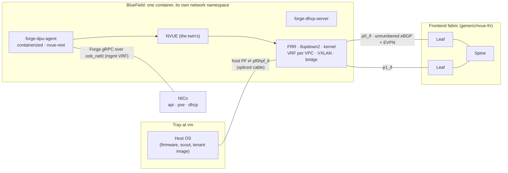

# Tenant isolation through an emulated BlueField — 2026-11-10

What NICo needs from a BlueField-3 to isolate tenants, what the twin has, and a design that gets
there without a ConnectX, a BFB or a DPU virtual machine: **NICo's own DPU agent, run as it runs
under DPF, configures an emulated HBN through NVUE, and the kernel's VRFs enforce each VPC.** It is
the DPU-enforced route ("Route A") of the Twin Isolation Plan for GPU Foundry's site; the
switch-enforced route needs no new design (section 1). Section 6 lists the decisions, section 7
a phased path, section 8 the findings (`I-nn`) for later changes to cite. **Built on 2026-11-10:**
section 10 says what, where real FRR and the kernel made it differ from sections 3 and 4, and
how it is tested. The design is proposed as [D71](../spec/11-decisions.md#d71--a-bluefields-hbn-is-emulated-over-frr-nicos-own-dpu-agent-configures-it)
(D64 to D70 are taken by the critic's proposed chapter, 17, on another branch).

Read on 2026-11-10 from this repository at `41d9f90` and from NICo's source at its pinned commit
`02b92f1`. Paths under `crates/`, `docs/` and `pxe/` are NICo's.

## 1. Where the twin stands

| | What | Where |
|---|---|---|
| **Built** | BlueField BMCs fronted: certificates, mutual TLS, `ResetToDefaults`, the BFB push | [D51](../spec/11-decisions.md#d51--bluefield-bmcs-are-fronted-by-the-bluefield-adapter-until-the-engine-has-dialect-handlers), [bluefield](../../internal/adapter/bluefield) |
| | A BlueField's Arm at `vm`: a pushed BFB installs and the DPU OS boots; DPF's agent reports from it | [D52](../spec/11-decisions.md#d52--a-bluefield-at-vm-has-an-arm-the-bmcs-bfb-push-installs), [arm.go](../../internal/adapter/bluefield/arm.go) |
| | NICo's machine software impersonated on `model` machines: `nico-dpu-agent` registers each DPU, fetches its managed host's network configuration and reports it applied | [D58](../spec/11-decisions.md#d58--nicos-software-on-a-model-machine-is-impersonated-on-the-machines-own-network-path), [agent.go](../../internal/adapter/nicoagent/agent.go) |
| | Switches built from what Cumulus is built from, configured through an emulated NVUE: revisions, a schema subset, FRR, ifupdown2 and the kernel underneath; a tenant VRF with an L3 VNI over EVPN, tested between two `vm` hosts | [D56](../spec/11-decisions.md#d56--cumulus-is-nvue-emulated-over-what-cumulus-is-built-from-genericnvue-frr), [nvue](../../internal/nos/nvue), `TestVMHostsOnRealNOS` |
| | A `vm` host's NIC spliced onto a TAP that is a real NOS's port | [D57](../spec/11-decisions.md#d57--a-vm-hosts-port-on-a-real-nos-is-that-switchs-port-its-nic-spliced-onto-a-tap), [splice.go](../../internal/adapter/netsim/splice.go) |
| **Missing** | Anything that enforces a VPC on a DPU. The stand-in echoes NICo's configuration back as applied ([nicoagent.go](../../internal/adapter/nicoagent/nicoagent.go), its `isNot`) | I-01 |
| | A ConnectX at `vm`: the Arm has one NIC, `oob_net0`; no `p0`/`p1`, representors or SFs, so DPF's agent stops at `nvconfig` (Q1) | I-02 |
| | A host's traffic crossing its DPU. A GB tray has no Ethernet port of its own; [`compile.HostPorts`](../../internal/compile/compile.go) hands the host its `model` BlueField's `p0` and `p1` as its own NICs, and the leaf makes them VLAN access ports | I-03 |

The switch-enforced route ("Route B") is mostly built: with `nos: generic/nvue-frr` on the TAP
substrate, an NVUE client moves a port to a VLAN (`interface swpN bridge domain br_default access`),
the switch's own `ifreload` applies it, and a tenant VRF keeps segments apart (D56, D57). It needs
estate configuration, not this design.

## 2. What NICo does with a BlueField

### 2.1 Provisioning

`DpuDiscoveringState` (rshim, Secure Boot, UEFI HTTP boot, a reboot of every DPU), then
`DPUInit/InstallDpuOs`, then `DPUInit/Init`, which waits for forge-scout on each DPU to report
`DiscoveryCompleted`, then `WaitingForNetworkConfig`, which waits until every DPU reports the host's
network configuration version applied with no `PreventHostStateChanges` alert
(`docs/architecture/state_machines/managedhost.md`; `crates/machine-controller/src/handler.rs`).
NICo installs the DPU OS by a Redfish push of its own `forge.bfb` only when the BMC runs 24.10 or
later and `[dpu_config] dpu_enable_secure_boot` is true (default false,
`crates/api-core/src/cfg/file.rs:4084`); otherwise by UEFI HTTP boot of `carbide.efi`
(`docs/dpu-management/dpu-lifecycle-management.md`). `forge.bfb` is NVIDIA's public bf-bundle 3.2.3
with NICo's agent, DHCP server, HBN image and first-boot scripts added; its open build needs no
NVIDIA-internal input (`pxe/Makefile.toml`). The first boot (`pxe/templates/user-data`) stops at
its first failing command, and calls `bfcfg`, `mlxconfig`, `mlxprivhost`, `hbn-dpu-setup.sh`, sfc
and OVS before scout runs; it also sets 2,048 2 MiB hugepages (line 174).

### 2.2 The DPU agent

`forge-dpu-agent` has two platform types and two ways to configure HBN
(`crates/agent/src/command_line.rs:343-401`):

| | `dpu-os` (default) | `containerized` (as DPF runs it) |
|---|---|---|
| Identity | enumerates the hardware: DMI, `flint` on `/dev/mst/*`; refuses without a BlueField's DPU info (`lib.rs:904`) | reads `/data/hw_output.json`, the `DiscoveryInfo` an init container saved (`lib.rs:886-893`; `crates/host-support/src/hardware_enumeration.rs:43,1027`) |
| DOCA containers | waits, with no time limit, for a `doca_hbn` image in containerd (`agent_platform.rs:31-44`) | skipped |
| OVS, MTU, `pf0hpf` link state, LLDP, managed files, `bfvcheck` | run | skipped (`main_loop.rs:251-330`, `1283`) |

| | `container-exec` (default) | `nvue-rest` |
|---|---|---|
| HBN configuration | writes `nvue_startup.yaml`, then `crictl exec <doca-hbn> nv config replace / apply` | NVUE's REST API at `NVUE_HTTPS_ADDRESS` with `NVUE_USERNAME` and `NVUE_PASSWORD` (`crates/nvue-client/src/client.rs:593-600`): `POST /revision`, `DELETE` and `PATCH /?rev=`, `PATCH /revision/<id>` to apply, `GET /system` for the build, BGP neighbour state, the bridge MAC table |

Either way the health check finds HBN with `crictl ps --name=doca-hbn -o=json` and runs
`supervisorctl status`, `ifreload --all --syntax-check` and `vtysh` inside it, through
`ip vrf exec mgmt` unless `IGNORE_MGMT_VRF` is set (`hbn.rs:45-81`, `health.rs:161-212`). It needs
`frr`, `nl2doca`, `rsyslog` and the DHCP server RUNNING, BGP to the uplinks and route servers
Established, and HBN's files present. HBN's build must be 2.0.0-doca2.5.0 or later for NVUE
(`lib.rs:95`); from 2.3 its interfaces are `p0_if`, `p1_if`, `pf0hpf_if`, `pf0vfN_if`. The agent
acknowledges a configuration version only when NVUE, DHCP and any OVS restart succeeded
(`main_loop.rs:1200-1240`). The host's address comes from `forge-dhcp-server` inside HBN, on
`pf0hpf_if` or the admin VLAN. The agent obtains its machine certificate from `DiscoverMachine`
itself; it needs only the site's root CA, which the init container downloads or reads from a mount.

### 2.3 VPCs

NICo's default VPC type is **Ethernet Virtualizer** (`crates/network/src/virtualization.rs:27`): an
L2 VNI per segment in one bridge, the default VRF, and ACLs. **A VRF per VPC with EVPN type-5
routes is the FNN type**, which is chosen when the VPC is created and needs its tenant to exist
(`crates/api-core/src/handlers/vpc.rs:97-108`). The FNN configuration
(`crates/agent/templates/nvue_startup_fnn.conf`) gives each DPU a loopback that is VTEP and router
id, an ASN from the `fnn-asn` pool, unnumbered eBGP on `p0_if` and `p1_if` (`remote-as external`,
line 647), a VRF per VPC with its L3 VNI, route targets `<datacenter_asn>:<L3VNI>`, route maps,
prefix and community lists, static routes, and ACLs on the host's interfaces. Between tenants the
host is on the admin network, an FNN VPC itself when `[fnn.admin_vpc]` is enabled
(`cfg/file.rs:3026-3044`). NICo's own expected outputs for these templates are in
`crates/agent/templates/tests/*.expected`.

### 2.4 Switches and site configuration

Leaves facing DPUs run eBGP unnumbered (RFC 5549), accept per-DPU ASNs, and carry EVPN on those
sessions or through route servers (`docs/getting-started/prerequisites/network.md:58-162`). The
site defines the pools `lo-ip`, `vpc-dpu-lo`, `vpc-vni`, `vni`, `vlan-id` and `fnn-asn`, plus
`asn`, `datacenter_asn` and the FNN routing profiles. Pools are seeded on first start and can only
grow afterwards (`crates/api-db/src/resource_pool.rs:963`), so they are sized before NICo first runs.

## 3. The design

| | What |
|---|---|
| **Real** | NICo's API, PXE and DHCP; `forge-dpu-agent` and `forge-dhcp-server`, built from NICo's source at the pin; FRR, ifupdown2, the kernel's VRFs, VXLAN and bridges; supervisord and rsyslog; the tray's firmware and OS |
| **Emulated, labelled** | HBN's NVUE API (the twin's, extended to what NICo writes); `crictl`, answering for the DPU's own container; `nl2doca`, a program that does nothing (there is no hardware to offload to); the DPU's identity in `/data/hw_output.json`; HBN's interface names on the twin's cables |
| **Impersonated, as today** | The DPU's boot and install: D58's stand-in answers `carbide.efi` (`DiscoverMachine`) and forge-scout's `DiscoveryCompleted`, then hands over to the real agent |
| **Absent** | The ConnectX and DOCA flow offload, OVS, SFs and representors, rshim, the DPU OS itself |

## 4. The parts

**4.1 The DPU.** One container per BlueField whose host is at `vm`, built on the `generic/nvue-frr`
image (D56) with supervisord and rsyslog added, run by the TAP substrate in its own network
namespace as a switch is. supervisord runs `frr`, `rsyslog`, `nl2doca` (the no-op) and
`forge-dhcp-server-default`, so `supervisorctl status` is real. HBN's `/var/lib/hbn` is the
container's `/etc`, so the files the health check reads are the ones ifupdown2 and FRR use. A `mgmt`
VRF holds `oob_net0`. `crictl ps --name=doca-hbn` names the container itself and `crictl exec`
runs the command in it. The agent runs in the same container with `AGENT_PLATFORM_TYPE=containerized`,
`HBN_CONFIG_MODE=nvue-rest` and `NVUE_HTTPS_ADDRESS` at the container's own NVUE. The container
follows the BlueField's power, which follows its host's standby power.

**4.2 Identity.** The twin writes `/data/hw_output.json` from the model: a BlueField-3's DMI
(`board_name` containing BlueField), `aarch64`, and `dpu_info.factory_mac_address` equal to the
BlueField's `BaseMAC`, the same identity D58's stand-in sends in `DiscoverMachine` today. The
site's root CA is mounted (`InitContainerBootstrapCaSource::Mounted`). The agent's binary runs on
the twin host's architecture; NICo reads the DPU's architecture from the cached `DiscoveryInfo`.

**4.3 NVUE for HBN.** The emulated schema ([tree.go](../../internal/nos/nvue/tree.go)) grows to
what NICo's FNN and ETV templates write, and every path outside it stays refused by name:

| Missing today | Rendered as |
|---|---|
| BGP neighbours named by interface (`p0_if`), `type: unnumbered`, peer groups | FRR `neighbor <if> interface peer-group` |
| `route-import` and `route-export` with route targets; `path-selection multipath`; `nexthop-tracking` | FRR per-VRF `address-family` |
| `vrf <v> router static` | FRR static routes in the VRF |
| `router policy`: route maps, prefix lists, community lists | FRR route-maps and lists |
| `acl` and `interface <i> acl <a> inbound` | nftables in the DPU's namespace (Cumulus renders ACLs to iptables and ebtables) |
| `system api listening-address`, interface `type` and `vlan` variants | recorded; applied where they change the kernel |
| Reads: `GET /system` (build `HBN <version>`), BGP neighbour state per VRF, the bridge MAC table | from FRR (`vtysh … json`) and `bridge fdb` |

The test oracle is NICo's: each of its expected NVUE configurations applies through the REST API
and renders, and FRR and ifupdown2 accept the result.

**4.4 Wiring.** A BlueField with an emulated data plane presents its host one function per
physical function (`pf0hpf`, MAC the host PF MAC its BMC's Redfish reports), not its uplinks:
`HostPorts` changes for it. The tray's NIC is spliced (D57) onto a TAP named `pf0hpf_if` in the
DPU's namespace. `p0` and `p1` are TAPs that are leaf ports (D45), named `p0_if` and `p1_if` in the
DPU's namespace. `oob_net0` is plugged behind the BMC's switch port as D52's Arm NIC is, a second
DHCP client on the underlay.

**4.5 Leaves.** A leaf port cabled to such a BlueField is rendered as a routed, unnumbered eBGP
interface (`remote-as external`, IPv4 unicast and L2VPN EVPN), not a VLAN access port; spines carry
EVPN. Leaves hold no tenant VRF.

**4.6 Hand-off.** D58's stand-in keeps the DPU's boot. Where the installed DPU OS would start, the
twin starts the container and the real agent instead of the stand-in's agent loop, and the host's
DHCP is answered by `forge-dhcp-server` in the container rather than by the stand-in's port relay.

**4.7 Events.** Every NVUE revision a client creates, changes or applies, on a DPU or a switch, is
a committed `request` event with a canonical name and the client as principal. Today NVUE writes
leave no event, so neither the console nor the critic sees a VPC applied or a port moved (I-07).

**4.8 NICo's configuration.** `dpu_policy = "manage"`; VPCs created as FNN; `[fnn]` with the admin
VPC enabled; the pools sized once; `datacenter_asn`; no route servers (EVPN rides the leaf
sessions); `min_dpu_functioning_links = 2`. `dpu_enable_secure_boot` does not matter, as the
install is impersonated.

## 5. Fidelity

**It shows** NICo's own agent computing, applying and acknowledging each VPC's configuration;
tenant traffic separated by kernel VRFs on the host's only path; EVPN type-5 routes between DPUs
over real FRR; NICo's synced and health gates passing on real BGP state; the host leased by NICo's
DHCP server through its DPU.

**It is not** a BlueField's data path: no ConnectX, no DOCA offload (`nl2doca` does nothing; the
kernel forwards, with a userspace copy on each spliced cable); not HBN (its NVUE is the twin's, over
the subset NICo writes; ACLs are the twin's nftables); not the DPU OS (the boot and install are
impersonated, D58); and the agent runs as it does under DPF, not in the DPU OS. A run is labelled
impersonated (D24), and its fidelity report names the emulated HBN.

## 6. Decisions to take

**I-Q1 — Who renders the DPU's configuration.** NICo's real agent, or the stand-in rendering NICo's
configuration itself. *Recommendation: the real agent.* It is NICo's code that turns a VPC into
VRFs, route targets and ACLs, and its acknowledgement is what NICo's state machine gates on; a
twin-side renderer would test the twin.

**I-Q2 — What stands in for HBN.** NVIDIA's `doca_hbn` image, or the twin's NVUE over FRR.
*Recommendation: the twin's.* HBN needs `nl2doca` and SFs from a ConnectX the twin cannot give it
(Q1), asks 6 GiB under DPF on a DPU OS whose first boot reserves 4 GiB of hugepages, and is
NVIDIA-licensed; the twin's emulation is already the switch's, and NICo's expected outputs make a
precise oracle.

**I-Q3 — How an estate asks for it.** A new fidelity level, or an option on a `model` BlueField
whose host is at `vm`. *Recommendation: no new level.* An adapter, `hbn`, claims BlueFields at
`model` whose host is at `vm` on the TAP substrate when the estate enables it, and the report
says so, as D52's Arm is the `bluefield` adapter's.

**I-Q4 — The host's link.** *Recommendation: through the DPU* (4.4). A host that bypasses its DPU
cannot be isolated by it.

**I-Q5 — Leaf ports facing such DPUs.** *Recommendation: routed and unnumbered* (4.5), as NICo's
prerequisites require; numbered or VLAN access ports would need NICo's templates changed.

**I-Q6 — VPC types.** *Recommendation: FNN first, ETV second.* FNN is the VRF-per-VPC model the
plan describes; ETV is NICo's default and adds ACL-only separation in one bridge.

**I-Q7 — ACLs.** *Recommendation: nftables* for the IPv4, IPv6 and MAC rules NICo's templates use,
with `hw-offload` accepted and ignored.

**I-Q8 — Visibility.** *Recommendation: NVUE writes are committed events* (4.7), on switches as
well as DPUs.

## 7. A phased path

| Phase | Adds | Exit | Size |
|---|---|---|---|
| **P1 — NVUE for HBN** | The schema and rendering of 4.3; NVUE writes as events | Each of NICo's expected FNN configurations (L3, classic, dual stack, quarantined, admin) applies through REST to an `nvue-frr` container, and FRR and ifupdown2 accept the result | Large |
| **P2 — A DPU on the path** | The `hbn` adapter's container (4.1), `HostPorts` (4.4), routed unnumbered leaf ports (4.5) | Two `vm` hosts behind two DPUs, each DPU given an FNN configuration by hand through NVUE: the hosts reach each other only within one VRF, and each leaf holds the other DPU's type-5 route | Medium |
| **P3 — NICo's agent** | The agent and DHCP server built at the pin; identity and CA (4.2); the hand-off (4.6) | With NICo, a tray's DPU leaves `WaitingForNetworkConfig` on its real agent's acknowledgement, and the tray leases its admin address from `forge-dhcp-server` through the DPU | Medium |
| **P4 — Tenancy** | NICo's FNN configuration (4.8); a `compat/nico` run | Two instances in two tenants' FNN VPCs report their network synced; across tenants ping and TCP fail; a released host returns to the admin VPC | Small to medium |
| **P5 — ETV** | ETV's configuration and ACLs | The same exit as P4 with VPCs of NICo's default type | Medium |

Foundry's part (re-enrolling the tray as `hostClass: dpu`, the DSX adapter's network half, FNN
VPCs) follows P4 and is not the twin's.

## 8. Findings

| Id | Sev | Finding | Proposed resolution |
|---|---|---|---|
| I-01 | B | Nothing on the twin enforces a VPC on a DPU: the stand-in reports NICo's configuration applied without applying it | P2, P3 |
| I-02 | B | A BlueField at `vm` has no ConnectX: one NIC, no `p0`/`p1`, representors or SFs (Q1) | I-Q2: not needed by this design |
| I-03 | B | A tray's traffic never crosses its DPU: `HostPorts` gives the host the BlueField's uplinks as its own NICs | 4.4, P2 |
| I-04 | M | The emulated NVUE keys BGP neighbours by address only and has no peer groups, route targets, route policy, static routes or ACLs | 4.3, P1 |
| I-05 | M | `generic/nvue-frr` switches run numbered eBGP only; NICo's DPUs require unnumbered | 4.5, P2 |
| I-06 | M | The plan's Route A assumes a VRF per VPC; NICo's default VPC type has none (FNN must be chosen), and NICo's default DPU install is UEFI HTTP boot, which the twin's Arm cannot do | 4.8, I-Q6 |
| I-07 | m | NVUE writes leave no event: the console and the critic cannot see a VPC applied or a port moved | 4.7, P1 |

## 9. To settle while building

- The tray's firmware booting from NICo's DHCP through its DPU: PXE or HTTP boot from aarch64 edk2
  over the spliced cable (P3).
- `forge-dhcp-server` under supervisord, or as the agent's gRPC peer (`--dhcp-grpc-server`) (P3).
- The HBN build string `GET /system` returns: the version in NICo's `forge.bfb`
  (`doca_hbn:3.2.3-doca3.2.3`, `pxe/Makefile.toml`) (P1).
- Whether Foundry's DSX adapter creates FNN VPCs (Foundry's side, before P4).

## Sources

NICo at `02b92f1`: `crates/agent/src/{command_line,lib,main_loop,health,hbn,agent_platform}.rs`;
`crates/agent/templates/nvue_startup_fnn.conf` and `templates/tests/*.expected`;
`crates/nvue-client/src/client.rs`; `crates/host-support/src/hardware_enumeration.rs`;
`crates/network/src/virtualization.rs`; `crates/api-core/src/{cfg/file.rs,handlers/vpc.rs}`;
`crates/api-db/src/resource_pool.rs`; `crates/machine-controller/src/handler.rs`;
`pxe/Makefile.toml`, `pxe/templates/user-data`; `docs/dpu-management/dpu-lifecycle-management.md`,
`docs/manuals/network_isolation.md`, `docs/manuals/vpc/`,
`docs/getting-started/prerequisites/network.md`, `docs/architecture/state_machines/managedhost.md`.

This repository: D51, D52, D56, D57, D58 and Q1 in [11](../spec/11-decisions.md);
[`compat/dpf`](../../compat/dpf/README.md) (HBN's image, chart and resource requests);
[`compat/nico`](../../compat/nico/README.md) (the trays path and the Ready path).

## 10. Built (2026-11-10)

Every recommendation of section 6 was taken. What exists:

| Part | Where |
|---|---|
| NVUE's schema for NICo's FNN and ETV templates (4.3): BGP neighbours by interface (unnumbered) and peer groups, peer address families with policy and `allowas-in`, VRF address families with networks, multipaths and route leaking, route targets, path selection, static and blackhole routes, next-hop tracking, router policy (prefix, community and AS-path lists, route maps), ACLs and their bindings, VRR, VRF loopbacks, the `frr.conf` snippet; refused by name outside it | [tree.go](../../internal/nos/nvue/tree.go), [frr.go](../../internal/nos/nvue/frr.go), [render.go](../../internal/nos/nvue/render.go) |
| ACLs to nftables (I-Q7): forwarded traffic only, as Cumulus; bridged traffic in the bridge family's forward hook, routed in inet's, a bridge port recognised there by the mark its prerouting hook gave the frame; rules in order, an unmatched packet permitted; `hw-offload` accepted | [acl.go](../../internal/nos/nvue/acl.go) |
| NVUE's reads: `GET /system` (`HBN 3.2.3-doca3.2.3` on a DPU), a VRF's BGP and its neighbours with FRR's session state, `?include=` filters, `?diff=`, the bridge MAC table | [operational.go](../../internal/nos/nvue/operational.go) |
| NVUE writes as committed `request` events (4.7, I-07): `network.config.revision`, `.change`, `.discard`, `.apply`, the client as principal, on switches and DPUs | [substrate_linux.go](../../internal/adapter/netsim/tap/substrate_linux.go) `startNVUE` |
| `spec.adapters.network.hbn` (I-Q3): every BlueField at `model` under a host at `vm` on the TAP substrate is a NOS of its own, `emulated/hbn`, in a container of the twin's NVUE over FRR, ifupdown2 and nftables with HBN's interface names; its host's NIC is its host PF (`pf0hpf`, a port of the BlueField-3 profile whose MAC is the BaseMAC its BMC serves) spliced onto `pf0hpf_if`; its uplinks are its leaf's routed, unnumbered eBGP ports carrying EVPN, and every switch carries EVPN; it has no AS, loopback or routing of the twin's | [compile.go](../../internal/compile/compile.go) `hbn`, `HostPorts`; [plan.go](../../internal/adapter/netsim/tap/plan.go); [nos.go](../../internal/nos/nos.go) `HBN`; [nos-hbn](../../test/linuxnet/nos-hbn/Containerfile) |
| NICo's `forge-dpu-agent` and `forge-dhcp-server`, built from NICo's source at the pin on bookworm, mounted in each BlueField (`spec.adapters.network.nos.hbnBinaries`) | [hbn-build.sh](../../compat/nico/hbn-build.sh) |
| The fidelity report names the emulated HBN | `Substrate.Report` |
| The hand-off (4.6): the stand-in (D58) boots the BlueField and runs NICo's image, then the installed DPU OS starts NICo's own agent and DHCP server in the emulated HBN instead of the stand-in's agent loop. The DPU's `mgmt` VRF holds `oob_net0` with nico-api's and the PXE service's addresses and a site DNS; each connection the agent opens there is carried over the DPU's own out-of-band path (the stand-in's NIC at the BMC's switch port), so NICo sees the DPU's address and MAC. The agent runs without `IGNORE_MGMT_VRF` | [hbnagent_linux.go](../../internal/adapter/netsim/tap/hbnagent_linux.go) `StartHBNAgent`; [agent.go](../../internal/adapter/nicoagent/agent.go) `handOff`; `netsim.HBNAgents` |
| DHCP trapped to the DPU on the host's representors, as HBN traps it to the Arm: the bridge's broute, installed over netlink, so NICo's DHCP server (a UDP socket bound to `pf0hpf_if`) answers a host whose PF is a bridge port (NICo's admin network, ETV) | [trap_linux.go](../../internal/adapter/netsim/tap/trap_linux.go) |

**Where it differs from sections 3 and 4**, each because real FRR, ifupdown2 or the kernel made it:

- **FRR 10 in the DPU.** The emulated HBN runs FRR's own 10 release (deb.frrouting.org); the
  switches keep bookworm's 8.4.4. On 8.4.4, a DPU that loses one of two equal EVPN paths to a
  remote VTEP (an uplink pulled) has zebra drop that VTEP's router MAC while bgpd keeps the other
  path best, and the VPC routes into a black hole.
- **A changed AS restarts FRR** (`frrinit.sh restart`): frr-reload cannot change a `router bgp`'s
  AS, and deleting the old instance while VNIs exist crashes FRR 10's bgpd
  (`bgp_evpn_local_vni_add`). NICo gives a DPU one AS for its life; this is the oracle's case.
- **VRF stanzas are applied around frr-reload.** What a running VRF stanza (an L3 VNI, a static
  route) has that the new one does not is removed through `vtysh` before `ifreload`, while the
  VRF exists; the new stanzas follow; frr-reload never sends a `vrf` line into a `router bgp`
  context (D57's bug, and its deletion case).
- **A VRF given an L3 VNI while the fabric's sessions are up** has its import route targets taken
  away and given back after the apply, so bgpd imports the EVPN routes it already holds once
  zebra has the VNI. A VLAN whose VNI changes has its SVI and VXLAN devices made again. The
  bridge has a fixed MAC, as Cumulus gives it the switch's: the kernel takes a bridge's MAC from
  its lowest port, and the bridge's own entry in an L3 VNI's VLAN does not follow a change.
- **VRR is the SVI's own MAC and addresses**, not a macvlan (`address-virtual`), whose sysctls a
  container cannot write; to the segment's hosts the gateway is the same.
- **No reverse-path filter, and routes over a port without carrier ignored**, on switches and
  DPUs, as on a Cumulus fabric: with RFC 5549 next hops, the kernel's loose check drops a VXLAN
  packet that arrives on one uplink while the route back is on the other.
- **Route targets `auto`** render to nothing (FRR derives its own); community lists render
  without sequence numbers (frr-reload 8.4 cannot remove one by its sequence).
- **P3 and P4 run against a Forge API harness, not NICo.** The test answers NICo's agent's
  `DiscoverMachine`, `GetManagedHostNetworkConfig`, `FindInterfaces` and status calls with the
  network configuration NICo's core builds for an FNN VPC, as NICo's own `forge.proto` types it.
  The agent, its templates, its NVUE client and its DHCP server are NICo's; NICo's state machine,
  database and VPC allocation do not run (compat/nico runs those, without DPUs).

**Tests** (`scripts/linux-substrate-e2e.sh`, an x86_64 Linux host with KVM and rootless Podman):

- `TestNICoConfigsApply` (`internal/nos/nvue`, any host): each of NICo's expected NVUE
  configurations (`testdata/nico`, from NICo's `crates/agent/templates/tests`) through NICo's push
  sequence: it renders, and pushed again is no change.
- `TestHBNAppliesNICoConfigs` (P1's exit): the same configurations, one after another, in a real
  emulated-HBN container: FRR runs each one's AS and route maps, the kernel has its VRFs, the ACLs
  are loaded.
- `TestDPUIsolation` (P2's and P5's exits): three x86_64 hosts at `vm` behind emulated BlueFields,
  two on one leaf, each given FNN through NVUE as NICo's agent gives it: both unnumbered uplinks
  established (read as NICo's health check reads them); one VPC across racks over its L3 VNI, the
  leaves holding its type-5 routes and no VRF; the other VPC isolated on a shared leaf; the
  underlay reaching no tenant; an ACL dropping one TCP port; the MAC table; no change on the same
  configuration; events; a pulled uplink with the VPC kept; a host moved between VPCs and back; an
  ETV segment (an L2 VNI across DPUs, a VRR gateway on each).
- `TestDPUAgent` (P3's and P4's exits, with the harness): four hosts, one of them booting its
  firmware from the network. NICo's agent is started as the stand-in hands off
  (`StartHBNAgent`), and reaches NICo only through its `mgmt` VRF. It registers, renders and
  pushes its FNN configuration, and acknowledges its version healthy. The hosts lease their
  addresses from NICo's DHCP server on their DPUs, and VPCs isolate. A re-tenanted host is
  reconfigured by a new version. A released host is put on NICo's admin network, leases its
  admin address and reaches the admin gateway and no tenant. The network-booting host's UEFI
  PXE DHCP on its host PF is answered by NICo's DHCP server on its DPU. A pulled uplink is
  reported to NICo as `BgpPeeringTor`.
- `TestHBNBlueFieldIsHandedOff` (`internal/adapter/nicoagent`): a BlueField whose HBN is
  emulated is booted by the stand-in through NICo's (fake) boot service and image, then handed
  over with what the image installed, its `DiscoveryInfo` in the agent's own form, and a
  working path to nico-api. The stand-in's agent loop stops reporting for it, and a reset stops
  the real agent.

**NICo's own control plane** (`compat/nico/run.sh dpu`, x86_64 Linux): real NICo at the pin
drives a DPU-managed host whose BlueField's HBN is emulated, with NICo's own agent and DHCP
server on it, to `Ready`, then through a tenant instance in an FNN VPC and its release:
22 PASS, 1 KNOWN (machine validation off, NICo's default), 0 FAIL (compat/nico/README.md, the
DPU path). NICo's DPU state machine left `WaitingForNetworkConfig` on its agent's
acknowledgement; the host leased on its host PF from NICo's DHCP server on the DPU and booted
NICo's iPXE and scout through it; NICo allocated the tenant, VPC, VNI and DPU ASN, its agent put
the host into VRF `vpc_<VNI>`, the instance became Ready in the VPC, the fabric's default VRF held
only the host route NICo leaks for an internal profile, and the release put the host back on the
admin network. What that took, beyond the three things this section named before (a Supermicro
host profile with a BlueField-3, `oem-supermicro/sys-821ge-tnhr-bf3`, at `vm`; the host booting
through the emulated HBN; NICo's namespace cabled to the real-NOS spine, the leaves originating a
default route to the DPUs):
- the BMC naming the host's DPU boot options as Supermicro's does (`spec.dpuBootName`), which
  NICo's `set_boot_order_dpu_first` matches;
- a QEMU whose NVMe implements namespace management (S-15), for scout's sanitise, and drives
  whose guest zeroes unmap their sparse backing (both block nodes `discard: unmap`);
- an internal routing profile that leaks the underlay's default route into a VPC and its host
  routes out: NICo boots an instance's host through its discovery image from carbide-pxe.

Not covered there: the admin CLI's `instance allocate`, which selects hosts and interfaces by a
Mellanox PCI vendor the guest's virtio host PF does not have (the path calls `AllocateInstance`
itself), and two tenants on one host fabric under NICo (covered by `TestDPUIsolation` and
`TestDPUAgent` with a Forge API harness).
