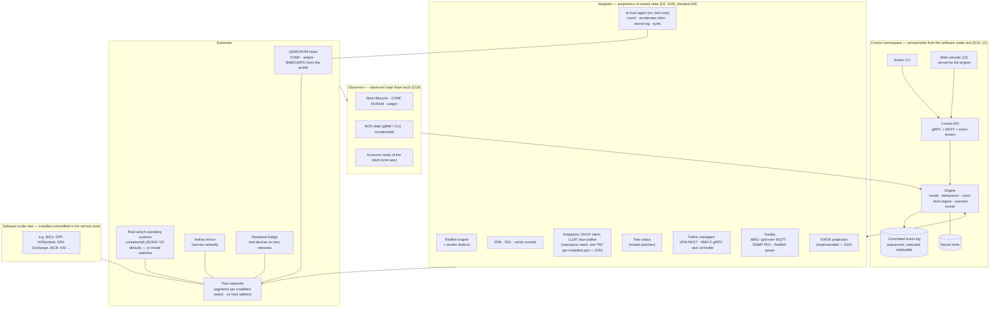

# 02 — Architecture

## Shape



The model sits in the engine. Adapters and the substrate are the only things the software under
test can reach, and they reach it only through the twin networks, the way a real site's
management cluster reaches its hardware. Observers carry back what the substrate decides on its
own.

## The engine

One engine process per estate. It is the **single writer** of the model.

| Part | Responsibility |
|---|---|
| **Compiler** | Turns the estate file, together with the packs it names, into the runtime model: devices, components, ports, links, domains, networks, addresses, credentials, and the adapter and substrate plan. Validates everything before anything starts, including every CEL expression ([03](03-estate-model.md), [13](13-schemas.md), [14](14-expressions.md)) |
| **Model store** | The current state of every device and component, each field **owned** or **observed** ([D19](11-decisions.md#d19--model-fields-are-owned-or-observed-observers-reconcile-the-substrate)), with versioned snapshots. In memory, persisted to a local file so `dctwin up` can resume; secrets live elsewhere ([15](15-security.md#secrets)) |
| **Behaviours** | Rules that turn a *request* into *owned state over time*: "power-on takes 40 s and fails if the rack's busbar has fewer than its minimum shelves", "a firmware update stages, then applies on the next reset". Each comes from a device profile, with defaults from the core ([04](04-devices-and-racks.md#behaviours)) |
| **Clock** | Virtual or wall ([08](08-scenarios-and-faults.md#clocks)). Every committed event carries both |
| **Fault engine** | Resolves a fault from a pack's catalogue into effect verbs on the model and applies them ([08](08-scenarios-and-faults.md#faults)) |
| **Scenario runner** | Executes scenario files: setup, timed steps, waits and assertions; reads the stack only through declared accessors |
| **Committed event log** | Requests, behaviour transitions, faults, acts, health changes and observer reports, with sequence, clock time, wall time and cause; redacted; retained and compacted by policy ([D27](11-decisions.md#d27--committed-and-derived-state-event-retention-and-redaction)). Derived state (sensors, computed power) is never logged |
| **Control API** | The only way into the engine for humans, scripts, the console and adapters. Authenticated, bound to the control namespace ([09](09-runtime.md#control-api), [15](15-security.md)) |
| **Web console** | A static bundle the engine serves on the control address; a client of the control API and nothing else ([12](12-ui.md)) |

## The core loop: request → behaviour → owned state → projection

```
 software under test            adapter                    engine                         other adapters
 ───────────────────            ───────                    ──────                         ──────────────
 POST …/Actions/                 Redfish engine  ──request──►  canonical: power.on
   ComputerSystem.Reset            (dialect maps            behaviour: tray power-on
   {ResetType: On}                 action→canonical)        precondition: busbar ≥ minSources ✓
                                ◄──202 + Task────             owned: PoweringOn            ──►  libvirt: start VM (if vm)
                                                              committed event #4812            power shelf: +draw (derived)
                                                                                               PDU / BMS: rack power (derived)
                                                                                               NMX-C: tray's lanes up
                                                                                               KWOK: node appears (if enabled)
 observer (vm only)          libvirt reports the domain running  ──► observed: power = On ──► Redfish: PowerState On
```

- **Adapters translate protocol requests into model requests**, and never change state
  themselves. The engine applies the profile's behaviour, which may take time, may fail, and may
  depend on other devices.
- **Adapters project committed owned state.** Each subscribes to the parts of the model it
  renders. A read is answered from the latest committed snapshot, so two adapters never disagree
  about an owned field for longer than one event's delivery.
- **Observed fields arrive from observers** as committed events, and adapters project them the
  same way. Between a substrate change and its observation the model is stale, and the fidelity
  report lists every substrate-owned field a run depended on ([07](07-fidelity.md#isnot-and-the-fidelity-report)).
- **Ordering.** The model applies changes in event-log order. A projection may lag, never
  reorder; lag beyond a threshold is a twin incident ([16](16-testing.md#twin-incidents)).
- **Writes from different interfaces converge.** A power-off through IPMI and a power-on through
  Redfish are two requests to the same behaviour, ordered by the engine, and both carry a
  canonical request name ([14](14-expressions.md#canonical-request-names)).

## Observers

An observer watches one substrate and reports **observed** fields into the model
([D19](11-decisions.md#d19--model-fields-are-owned-or-observed-observers-reconcile-the-substrate)).

| Observer | Reports |
|---|---|
| libvirt | domain running, paused, crashed or off; a guest-initiated reboot or shutdown; console availability |
| OVMF NVRAM | boot order and one-time overrides as the firmware holds them (read on shutdown and on demand); Secure Boot databases as enrolled from inside the OS |
| swtpm | EK presence; PCR banks after boot (for the console, never for the stack) |
| NOS | port operational state, LLDP neighbours, BGP session state, relay state, the routing table (read-only, for assertions and the console) |
| containerlab | topology up, a container restarted (a twin incident) |
| stack accessors | the stack's own view of a machine or alert, through declared read-only accessors, over the one-way path ([15](15-security.md#network-isolation-d10)) |

Observers originate every connection; nothing on the substrate side can reach the control
namespace.

## Adapters

An adapter is a process that implements one protocol engine for many devices. Whatever is
vendor-specific is supplied as **dialect data, request maps and hooks from packs**
([05](05-interfaces.md), [06](06-packs-and-stacks.md)).

- **One endpoint per modelled switch port** ([D20](11-decisions.md#d20--endpoints-are-hosted-per-modelled-switch-port)).
  A model-fidelity estate can have thousands of BMCs, each with its own MAC, IP, LLDP identity and
  switch port. The endpoint adapters run a **userspace network stack** that owns one TAP per
  modelled switch port, veth-wired into a real NOS's interface or bridged into a model switch's
  segment. One process presents thousands of endpoints without a kernel stack each, and every
  per-port fact a lifecycle manager keys on (circuit id, LLDP neighbour, link state) matches the
  model's cabling.
- **Sharded.** Adapters run per shard (a rack group or N endpoints) in their own network
  namespaces. A shard restart is a committed twin incident and never looks like a site-wide BMC
  outage; an endpoint-level act (a BMC reset) restarts no process.
- **Scoped by the stack's call list** ([D25](11-decisions.md#d25--a-protocol-engines-scope-is-the-stacks-call-list-the-dialect-binding-is-data)).
  A protocol engine implements what the stacks under test call, mapped to canonical requests;
  the dialect binds a captured mockup to the model with data (JSON-pointer overlays and an
  action map), and only what data cannot express is code.
- **Reused upstream emulators** run as sidecars behind the same adapter interface, for example a
  vendor's UFM mock or a NOS container. The adapter keeps them in step with the model, or the
  pack marks them as holding their own state, which the fidelity report then prints as
  **unsynchronised** ([D7](11-decisions.md), [07](07-fidelity.md)).

## The substrate

| Piece | What it is | Used for |
|---|---|---|
| **QEMU/KVM hosts** | VMs with OVMF (UEFI, Secure Boot), swtpm (TPM 2.0, state persisted per device path, EK certificate from the estate CA), **SMBIOS serial and UUID, NIC MACs and PCI stub devices from the profile's identity and components**, virtio NICs on twin segments, and disks. Same architecture as the host, or TCG with `--allow-tcg` ([09](09-runtime.md#where-it-runs)) | `vm`-fidelity servers, compute trays and DPU stand-ins: anything that must really PXE-boot, install an OS, run an agent or attest |
| **In-host agent** | A small twin process inside a `vm` host in **`os: twin`** mode only ([D23](11-decisions.md#d23--two-in-host-modes-for-vm-hosts)), reachable **only over virtio-vsock** | Applies in-host projections: the accelerator-library shim (NVIDIA's Mokka; AMD and Intel equivalents later), kernel-log lines a driver would print, a bind-mounted sysfs tree for Go consumers, NIC counters. Never on a twin network. An `os: stack` host has none |
| **Switch operating systems** | Real NOS images in containers or VMs, wired by containerlab from the model's cabling, **or model switches** (`nos: none`, [D21](11-decisions.md#d21--model-switches-are-a-fidelity-level-fabric-device-fidelity-derives-from-nos)) | Real: BGP, EVPN, LLDP, DHCP relay by giaddr, the NOS's management API. Model: cabling, port state, LLDP, counters and the twin relay; no routing protocol |
| **Twin networks** | One or more L2 segments per declared network: containerlab links where a NOS serves them, per-port TAPs bridged per segment where a model switch does. No host address, no forwarding to the host ([15](15-security.md#network-isolation-d10)) | management (OOB/BMC), provisioning, frontend, scale-out, storage, service |
| **Service zone** | VMs, or a Kubernetes cluster on VMs, that the twin provisions from the stack definition, on the `service` network and the roles the stack attaches | Where a stack's own control plane runs, for example NICo's three-node site controller |
| **Artifact mirror** | A registry and HTTP cache on the `service` network, populated before the run | Where the stack installs from, so a run needs no internet and the control namespace is never an upstream ([15](15-security.md#the-install-path)) |
| **Hardware bridge** | A dedicated physical NIC bridged into a twin network, isolated, accepting only the configured device's frames | A real server, BMC, DPU or switch taking part in the estate ([07](07-fidelity.md#hardware)) |

## The software under test

A stack is installed by its **stack definition** ([13 — Stack](13-schemas.md#stack)): which
service-zone machines it needs, which networks they attach to, which images and charts it installs
(by digest, from the mirror), which tenant clusters the twin must build on `vm` hosts for it, and
which capabilities it requires of the estate. The twin hands the stack what a real site would hand
it, through the definition's `inputs` (BMC subnets, the relay targets, the UFM URL, the BMS broker,
the estate CA), and receives through its `outputs` only what the twin's own adapters need (the
broker's address and credential, a cluster kubeconfig). It hands over nothing else.

## Isolation of the twin itself

- The control namespace, the event log, the secret store and the in-host vsock channel are on no
  network the software under test is attached to; adapters cannot forward; observers originate
  every connection; the install path never reaches the control address. The mechanism and the CI
  test that proves it are in [15](15-security.md).
- Emulated devices expose only the interfaces their real counterparts expose, and **nothing a
  lifecycle manager is known to key on reveals them**: ServiceRoot identity strings, system and
  chassis ids and models, DHCP vendor class, IPMI manufacturer id, LLDP identity. Where a reused
  emulator would leak (sushy-tools' `Vendor: Sushy`), the pack's dialect replaces it. TCP
  fingerprints, timing and certificate chains do differ, and the twin does not claim otherwise.
- Credentials in profiles are generated per estate and live in the secret store. The twin never
  accepts or stores a real device's credentials, except in `hardware` mode, where the operator
  supplies them through the control API by reference and they never reach the estate file, the
  snapshot or the event log.
